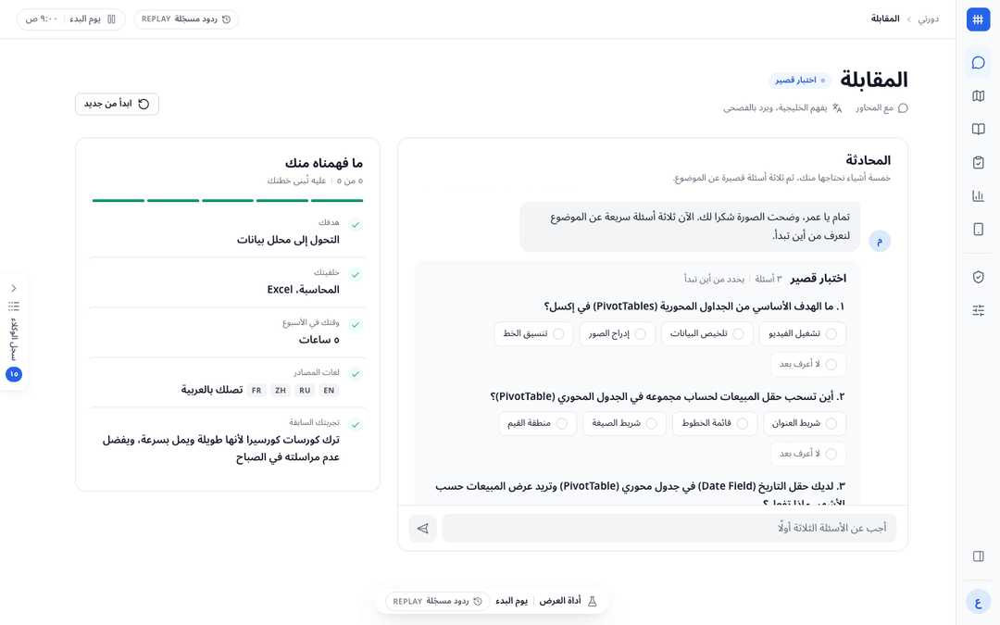

# CuraLoom

CuraLoom is a working name. The app reads its name from `APP_NAME` through `src/config.ts`, and the default there may change before the final release.

CuraLoom builds a personal course in Arabic from openly licensed learning material in English, Russian, Chinese and French. A coach follows the learner when they stop studying, and proposes a new plan when they come back. It runs on Meta's Muse models and was built for the Meta Global AI Developer Hackathon (Indie track).



Stills from a scripted walk of `pnpm demo:replay` at 1440×900, not real time. The run replays recorded model answers, and the badge at the top of each page says so.

## The problem

Most good learning material is not in Arabic, and adults who study alone around a job drop long courses. The sample learner, Omar, is a 28-year-old accountant who wants to move into data analysis. Omar has about 5 hours a week, reads English, and has dropped online courses before.

## What the app does

1. An intake agent interviews the learner in their own dialect, by text or voice, and records their goal, background, weekly hours and past attempts. A short check sets the starting level.
2. A scout searches the open web in English, Russian, Chinese and French. Code fetches each cited page and decides its licence from the page text. A model's claim about a licence does not count.
3. An architect designs a course around the learner's hours.
4. A lesson builder writes each lesson in Arabic beside the source excerpt it explains. Every term gets a bilingual glossary card, and every excerpt shows its source and licence. When a source page has a diagram whose licence allows changes, Muse Image rewrites its labels in Arabic. Code then compares Spark's transcripts of the source and the edit before the lesson shows it. When the check fails twice, or the licence forbids changes, the lesson shows the original with its labels translated in a table.
5. An examiner writes and grades a quiz for each lesson. The next lesson opens only at 80%.
6. When the learner stops studying, a coach sends a reminder on day 2, offers a lighter week on day 5 and checks in on day 10. It sends messages only with the learner's consent and holds them during the quiet hours the learner set. The word «توقف» ("stop") ends the messages.
7. When the learner comes back, a five-question recap shows what they still know. Code proposes a new plan version, Muse Spark explains the change in Arabic, and nothing changes until the learner accepts.

A trace drawer shows each model call, tool call and decision as it happens, with its cost.

## Architecture

CuraLoom is one Next.js app. The browser renders a right-to-left Arabic UI. Route handlers run an orchestrator, which steps through the agents: intake, scout, architect, lesson builder, diagrams, examiner and coach. The orchestrator checks each step's output against its TypeBox contract in `contracts/index.ts`, retries once on failure, saves the output and traces the step.

- Agents call models only through the provider layer in `src/server/providers/`. It routes each call by role through `config/models.yaml`, and it runs in one of three modes: `live`, `record` or `replay`.
- Session state and traces are JSON files under `data/`.
- A simulated clock and a simulated phone inbox stand in for time and messaging. No real message leaves the app.
- Code, not a model, checks licences, grades multiple-choice answers, enforces the 80% gate and makes every plan change.

[`docs/architecture.md`](docs/architecture.md) has the component map, the folder layout and a section per agent. [`docs/coach.md`](docs/coach.md) covers the coach. The decisions behind the design are in `docs/adr/`:

- [ADR-001](docs/adr/0001-stack-nextjs-typescript.md): One Next.js and TypeScript app.
- [ADR-002](docs/adr/0002-provider-abstraction.md): All model access goes through one provider layer.
- [ADR-003](docs/adr/0003-storage-json-files.md): JSON files for the state store.
- [ADR-004](docs/adr/0004-simulated-notifier-and-clock.md): A simulated notifier and an injectable clock.
- [ADR-005](docs/adr/0005-no-embeddings.md): No embeddings or vector store. Use long context.
- [ADR-006](docs/adr/0006-contracts-typebox-strict.md): Contracts are TypeBox schemas that double as strict response formats.
- [ADR-007](docs/adr/0007-ui-css-modules-icons-fonts.md): Plain CSS with tokens and CSS Modules, lucide-react icons, and Noto fonts through `next/font`.
- [ADR-008](docs/adr/0008-replans-are-code-made-proposals.md): Re-plans are code-made proposals, made once per comeback.

## Meta models

Every model call goes to the Meta Model API through the provider layer. `config/models.yaml` maps each role to a model, so a model change is an edit there. What each model does:

- **Muse Spark 1.3:**
  - the interview (`agent_default`);
  - the scout's web search with citations and its description of each source (`agent_default`). Code reads each source's page and verifies its licence;
  - lesson writing (`agent_default`);
  - quiz writing (`agent_default`) and grading of short answers (`judge`);
  - the coach's messages (`coach`);
  - the re-plan's explanation and the choice of a new source (`replan`);
  - reading a diagram's labels and translating them with the course glossary (`diagram_labels`), and transcribing the source diagram and each relabelled copy for the code check (`image_text`).
- **Muse Wonder 1.0:** the course design (`curriculum`).
- **Muse Voice Transcribe 1.0:** the learner's voice message in the interview (`transcribe`). The transcript fills the message box, and the learner checks it before sending.
- **Muse Image 1.0:** a source diagram with its labels rewritten in Arabic (`image_edit`). Code reads each image's licence and author from its Wikimedia file page, and edits only public domain, CC0, CC BY and CC BY-SA images.

The provider layer uses these API features:

- Structured output. Each agent-output contract is also a strict `json_schema` response format, and code checks every reply against it with `validate()`.
- Web search with URL citations. Only cited URLs can become resources.
- Reasoning effort per role: `medium` for `agent_default`, `low` for `coach` and `replan`.
- Cost per call, from the token prices in `config/models.yaml`. The trace shows it.

`config/models.yaml` also routes `segment` (SAM 3.1), which no feature calls. The diagram spike found no job for it ([`docs/spikes/image-arabic.md`](docs/spikes/image-arabic.md)).

## Set up

You need git, Node.js 24 or later, and pnpm 11.7.0, the version `package.json` names. `.nvmrc` and `.node-version` name Node 24 for nvm, fnm and CI.

```sh
git clone <repository URL> curaloom
cd curaloom
node -v
```

If `node -v` prints a version below `v24`, or no version, install Node 24 with [nvm](https://github.com/nvm-sh/nvm). Run this inside the clone, where `nvm install` reads `.nvmrc`:

```sh
curl -o- https://raw.githubusercontent.com/nvm-sh/nvm/v0.40.3/install.sh | bash
. ~/.nvm/nvm.sh
nvm install
node -v
```

`node -v` now prints `v24` and a minor version. Then get pnpm through Corepack, which comes with Node, and start the demo:

```sh
export COREPACK_ENABLE_DOWNLOAD_PROMPT=0
corepack enable
pnpm -v
pnpm install
pnpm demo:replay
```

`pnpm -v` prints `11.7.0`.

- `COREPACK_ENABLE_DOWNLOAD_PROMPT=0` stops Corepack from asking before it downloads pnpm. The question waits for an answer forever in a script, an agent or CI.
- `corepack enable` fails with `EACCES` when Node is installed for the whole system, because it writes links next to the `node` binary. Use Node from nvm as above, or run `corepack enable --install-directory ~/.local/bin` with `~/.local/bin` on your `PATH`.

When the server prints `Ready`, open http://localhost:3107/intake. The replay needs no API key. The three Noto fonts ship in `src/app/fonts/`, so after `pnpm install` the build and the demo need no network.

To call the models live, copy the settings file, set `MODEL_API_KEY` in `.env`, and start the live demo:

```sh
cp config/.env.example .env
# Set MODEL_API_KEY in .env.
pnpm demo:live
```

`pnpm demo:live` builds the app first. It then serves the app on port 3107, on 127.0.0.1 only, with its data in `.live-data/`, which it empties at start. When the server prints `Ready`, open http://localhost:3107/intake. The live demo uses the recorded topic, "Excel pivot tables for data analysis", unless `DEMO_TOPIC` is set in `.env` or the shell. Without a key, it stops before the build and says where to set the key. `config/.env.example` lists every setting with its default. Live calls cost money, and the trace shows each call's cost.

To run a second demo beside the first, such as the live demo beside the replay, give it another port with `DEMO_PORT`, in `.env` or the shell: `DEMO_PORT=3118 pnpm demo:live`. Each demo command builds into a folder of its own and keeps its own data, so its build leaves a running demo alone. When the port is taken, the command stops before the build and says so. The presenter steps and the video use the default, 3107.

For development only, `pnpm dev` runs the Next.js dev server on port 3000. It listens on every network interface, not on 127.0.0.1 only. Its default mode is `live`, so its model calls cost money too. Unlike `pnpm demo:live`, it does not fall back to the recorded topic. Without `DEMO_TOPIC` in `.env`, its topic is the placeholder `<DEMO_TOPIC>`. It keeps its data in `data/`.

| Command                                       | What it does                                                                                        |
| --------------------------------------------- | --------------------------------------------------------------------------------------------------- |
| `pnpm dev`                                    | Development only. Runs the dev server on every network interface. Its default mode is `live`.       |
| `pnpm check`                                  | Runs lint, typecheck and tests. The tests replay recordings, so they need no key.                   |
| `pnpm demo:replay`                            | Builds and serves the recorded demo on port 3107, paced like a live run.                            |
| `pnpm preview`                                | Builds and serves the recorded demo on port 3107 with no pacing, to check the UI.                   |
| `pnpm demo:live`                              | Builds and serves the demo on port 3107 with live model calls. Needs `MODEL_API_KEY`.               |
| `pnpm demo:reset`                             | Empties the demo's data under a running demo server.                                                |
| `pnpm eval:arabic --model <model>`            | Runs the Arabic quality eval. Needs `MODEL_API_KEY`.                                                |
| `pnpm fixtures:record`, `pnpm fixtures:prune` | Record the model replies the tests need, then delete the ones no test replays.                      |
| `pnpm notices`                                | Writes `THIRD_PARTY_NOTICES.md` from the installed packages, the fonts, the icons and the fixtures. |
| `pnpm e2e`                                    | Clicks the presenter steps in Chromium on a replay server, once per placement level. Build first.   |

## Replay mode

`pnpm demo:replay` builds the app and serves it on port 3107, on 127.0.0.1 only. Every model reply comes from a recording in `demo/fixtures/responses/`, and every web page from `demo/fixtures/pages/`. A badge in the top bar says «ردود مسجّلة» `REPLAY`. Replay waits 0.3 times each recording's latency, so the run paces like a live one. Set `REPLAY_LATENCY` to change the pace, or `0` to answer at once.

A recording answers only the exact request it was recorded for. Replay therefore always uses the recorded topic, "Excel pivot tables for data analysis" (`RECORDED_TOPIC` in `demo/script.ts`). The intake and quiz pages offer the recorded text as chips. Text you type yourself has no recording, so that step fails, and a banner names the missing recording.

[`docs/demo.md`](docs/demo.md) has the presenter steps, the reset procedure and how to record again.

## Arabic quality eval

`evals/arabic/items.jsonl` holds 30 items in six categories. Each model answers every item, and Muse Spark 1.3 judges each answer against the item's rubric. The run on 2026-10-27 gave these scores ([`docs/spikes/arabic-eval.md`](docs/spikes/arabic-eval.md)):

| Category             | Bar                 | Spark 1.3          | Wonder 1.0         |
| -------------------- | ------------------- | ------------------ | ------------------ |
| MSA explanation (6)  | 0.80                | 1.00               | 1.00               |
| Egyptian dialect (4) | 0.80                | 1.00               | 1.00               |
| Gulf dialect (4)     | 0.80                | 1.00               | 1.00               |
| Term translation (8) | 0.85                | 0.94               | 1.00               |
| Diacritics (3)       | 0.80                | 0.83               | 0.83               |
| Quiz generation (5)  | 0.80, no key errors | 1.00, 0 key errors | 1.00, 0 key errors |
| Overall (30)         | 0.80                | 0.97               | 0.98               |

A human review then ruled that both models' answer to one disputed diacritics item (`diac-02`) is correct. That raises the overall scores to 0.98 for Spark and 1.00 for Wonder. The judge gave full marks to 57 of 60 answers, so these items set a floor for basic Arabic quality. They do not rank the two models. To run the eval again, use `pnpm eval:arabic --model <model>`.

## Limitations

- The demo topic is Excel pivot tables for data analysis. Replay plays only the recorded path on it, and the live demo uses it unless `DEMO_TOPIC` is set. A replay on another topic needs a key and a new recording, as `docs/demo.md` describes.
- There is one sample learner in one session, with no accounts and no authentication. The demo servers listen on 127.0.0.1 only for that reason.
- Messages go only to the simulated phone inbox. The `whatsapp` and `email` notifier adapters are stubs that throw.
- Time is simulated. The demo bar moves the clock.
- Storage is JSON files on the local disk, for one server process.
- The licence checker reads the licence statements in a page's text. CC BY, CC BY-SA, CC0, MIT, Apache-2.0 and public domain count as open. A licence with NC or ND counts for personal study only, and a page with no licence statement is rejected.
- The recorded run kept no Chinese source. The one Chinese page it read is under MPL-2.0, which is not on the allowlist.
- In replay, the voice message is one bundled clip in a synthetic Arabic voice. The presenter then sends the recorded typed message, because the transcript differs from it by a few letters.
- Diagrams come only from Wikimedia pages, at most one per lesson. An image is skipped when any licence on its file page is off the allowlist, so a common CC BY-SA and GFDL pair is skipped too. In the recording, Muse Image's two edits of lesson 1's VisiCalc screenshot both failed the code check, so lesson 1 shows the source with a table of labels. Lesson 2's pivot table passed and shows in Arabic.
- There is no on-device model. A local Muse Glimmer coach was dropped (#29): Meta's API does not serve Glimmer, and a 17 GB model on each learner's machine is not realistic.
- Messages held for quiet hours are not withdrawn when the learner comes back.

## Licence

The code is licensed under the [Apache License 2.0](LICENSE). Copyright 2026 Ahmed Nagdy.

Third-party packages, fonts, icons and the recorded source pages keep their own licences. [`THIRD_PARTY_NOTICES.md`](THIRD_PARTY_NOTICES.md) lists each one.

The code licence does not cover the recorded pages and model replies in `demo/fixtures/`, which keep the licences of their sources. [`demo/fixtures/LICENSE.md`](demo/fixtures/LICENSE.md) explains them. Replies built on Wikipedia and Wikibooks text are CC BY-SA 4.0, and the stored pages include one CC BY-NC-SA 4.0 page and one MPL-2.0 page.

The demo GIF, `docs/media/demo.gif`, shows excerpts of the Wikipedia articles [«Tableur»](https://fr.wikipedia.org/wiki/Tableur) (French), [«Сводная таблица»](https://ru.wikipedia.org/wiki/Сводная_таблица) (Russian) and [Pivot table](https://en.wikipedia.org/wiki/Pivot_table) (English), and the Arabic lesson and quiz written from them. That material is by the articles' Wikipedia contributors and stays under [CC BY-SA 4.0](https://creativecommons.org/licenses/by-sa/4.0/).
