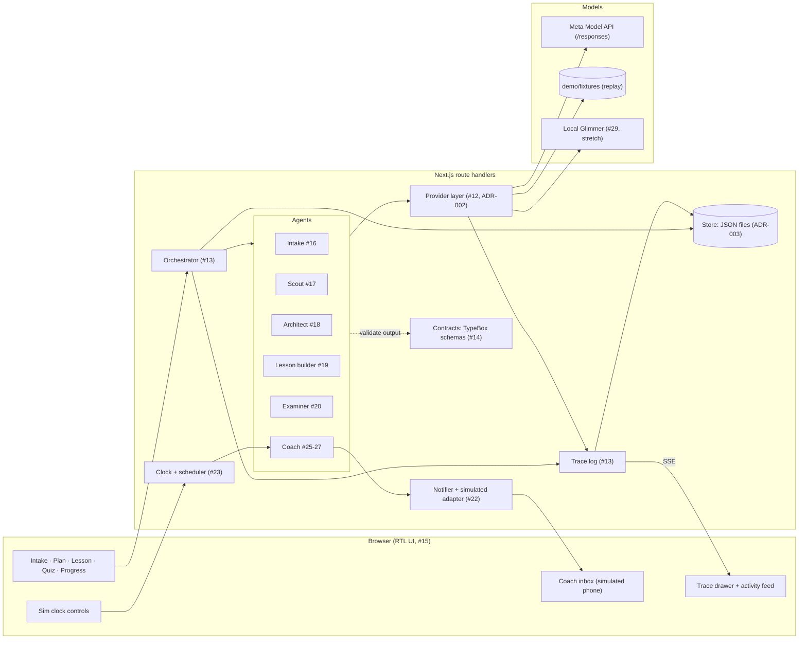

# Architecture

One Next.js app (ADR-001). The browser renders an Arabic RTL UI. Route handlers run the orchestrator, which steps through named agents. Agents reach models only through the provider layer, and every step writes trace events that stream back to the UI's trace panel.



## Components

| Component      | Owner issue      | Responsibility                                                                                                              |
| -------------- | ---------------- | --------------------------------------------------------------------------------------------------------------------------- |
| Config         | #11              | `src/config.ts` reads `.env`. The only place that reads `APP_NAME`, `DEMO_TOPIC` and the other settings.                    |
| Contracts      | #14              | TypeBox schemas for every entity (ADR-006): TS types, runtime validation, and strict `json_schema` response formats in one. |
| Provider layer | #12              | One interface for all model calls, routed by role. Modes `live`, `record` and `replay`.                                     |
| Orchestrator   | #13              | Runs agents as typed steps over session state. Validates each output against its contract and retries once on failure.      |
| Store          | #13              | Session state and trace events as JSON files under `data/`.                                                                 |
| Trace          | #13              | Event per model call, tool call, decision, output or error, with Arabic and English summaries, model, cost and latency.     |
| UI shell       | #15              | The RTL Arabic UI in `src/app`: nav, top bar, trace drawer. One live trace stream feeds the drawer and the activity feed.   |
| Agents         | #16-#20, #25-#27 | Intake, Scout, Architect, Lesson builder, Examiner, Coach.                                                                  |
| Notifier       | #22              | Consent-gated, channel-agnostic sending, quiet-hours deferral and stop words. Only the simulated adapter sends.             |
| Clock          | #23              | Simulated time per session, the only reader of system time. Moving it fires due coach rules in time order, exactly once.    |
| Evals          | #8               | Arabic quality eval in `evals/arabic`, reused as a regression test.                                                         |

## Layout

```
src/app/             UI pages and route handlers
src/app/_shell/      shell components and the live trace provider (#15)
src/app/routes.ts    route registry: the nav's only source
src/server/agents/   one folder per agent
src/server/orchestrator/
src/server/providers/
src/server/clock/    sim clock, coach scheduler, sim and inbox route handlers (#23)
src/server/notifier/ notifier, consent gate, adapters (#22)
src/server/demo/     dev-only dummy agent and its runner (#15)
src/server/store/
src/server/tools/    tools agents call, such as the page fetcher (#17)
src/server/trace/
src/config.ts
contracts/           entity schemas and types (#14)
config/              .env.example, models.yaml (#12)
evals/               model evals (#8)
demo/fixtures/       seeded state, recorded responses and recorded pages
docs/adr/            decisions
spikes/              throwaway Day-1 spikes (Python, not in CI)
```

Folders are created by the issue that first puts code in them.

## UI shell (#15)

- Routes: `/intake`, `/plan`, `/lesson`, `/quiz`, `/progress`, `/coach`, `/consent`, `/settings`. `/` redirects to `/plan`. `src/app/routes.ts` lists each route's id, path, Arabic label, icon and group (`learn` or `account`), and the nav reads only from it.
- `/dev/bidi` is the mixed-direction test page (Arabic, English, Russian, Chinese). It is not in the nav.
- The UI shows the session `DEMO_SESSION_ID` from `demo/session.ts` until real sessions exist.
- One client provider in `src/app/_shell/` opens a single `EventSource` to `/api/sessions/{id}/trace/stream` and keeps the events. The trace drawer and the plan page's activity feed both read from it. `toActivityItem()` in `src/app/_shell/activity.ts` turns an event into a plain-Arabic feed line with no model ids or costs.
- `POST /api/dev/dummy-run` (optional body `{"sessionId"}`, default the demo session) answers 202 and runs the dummy agent from `src/server/demo/` in the background, through the real orchestrator. It emits about 10 seconds of trace events with no model calls. Its first output fails its contract, so the orchestrator's retry shows in the trace. It answers 409 while that session already has a run. Dev tools follow `config.devTools` (off in a production build): there the route answers 404, the drawer's «تشغيل تجريبي» button is hidden and `/dev/bidi` is a 404.
- The dummy agent's output schema is a local TypeBox schema in `src/server/demo/dummy-run.ts`, not a contract in `contracts/index.ts`: a dummy result is not a domain entity (ADR-006).
- Every run appends to the demo session's trace in `data/sessions/demo`, and the feed and drawer replay it on each page load. Settings' reset keeps the trace. Clear it before recording the demo video: `rm -rf data/sessions/demo`.
- Styling, icons and fonts: ADR-007.

## Clock (#23)

- Simulated time is `SimTime = {day, minute}` (`src/server/clock/time.ts`), written `"day 2 19:00"`. A session starts at day 0 09:00.
- `wallNow()` in `src/server/clock/clock.ts` is the one place that reads system time. `src/guards.test.ts` fails on `Date.now()` or an argless `new Date()` anywhere else in `src/` (ADR-004).
- `createSimClock()` keeps each session's time in the `sim_clock` document. It only moves forward: `advance(by)`, `set(day)` to 09:00 of that day, and `reset()`. A move into the past throws `ClockError`. Each move emits a `clock` trace event.
- The tracer stamps every event with the session's sim time as `sim_ts`, beside the wall-clock `ts`. With `SIM_CLOCK=false`, `sim_ts` is null.
- `createScheduler()` (`scheduler.ts`) holds a rule table `{key, at, fire(ctx)}`. After each move it fires every rule due by the new time, in time order, and records its key in the `scheduler` document so a rule never fires twice. The rules for days 2, 5, 10 and 17 are placeholders with Arabic template text until the coach (#25) owns them.
- `createSim()` (`sim.ts`) wires the clock, scheduler and notifier for one session. `reset()` deletes the session's documents (the trace stays), which restores the seeded state.
- `POST /api/sessions/{id}/sim/{advance,set,reset}` takes `{days?, minutes?}`, `{day}` or nothing. It answers `{now, events}` with the coach events the move fired, 409 for a move into the past, and 404 while `SIM_CLOCK=false`.
- Settings has the clock controls. The top bar's clock pill reads the latest `clock` trace event, so every open tab follows a move.

## Notifier (#22)

- `createNotifier()` (`src/server/notifier/notifier.ts`) takes a message `{id, to, channel, template, text_ar, cta, sim_ts}` and answers `sent`, `deferred` with `deliver_at`, or `suppressed_opt_out`. The same id is sent once.
- `gate()` (`gate.ts`) is a pure table of rules over the consent and the sim time. It suppresses a message while consent is missing or withdrawn. During quiet hours, including hours that cross midnight, it defers the message to the end of the window. As the clock passes that time, the scheduler calls `deliverDue()`, which asks the gate again before it delivers.
- `receive(text)` is the inbound handler. A reply that is only a stop word (`توقف`, `إيقاف`, `stop` and variants, matched after removing case, tashkeel, tatweel, alef forms, punctuation and polite words such as «من فضلك») saves the opt-out at once, cancels held messages and sends one confirmation. A second stop word sends nothing.
- `NOTIFIER_ADAPTER` picks the adapter (default `simulated`). The simulated adapter appends to the session's `inbox` document. `whatsapp` and `email` are stubs that throw and list what a real adapter must do. `src/guards.test.ts` fails on `fetch`, sockets or an HTTP module import in `src/server/notifier/`.
- Notifier traces name the learner by id only, never by number or address, and carry no message text.
- `/coach` renders the phone from the inbox and the outbox (`phoneThread()`). `POST /api/sessions/{id}/inbox` with `{text}` is the learner's reply and answers `{opted_out, confirmed}`.

## Scout (#17)

The scout finds open-licence learning resources on the learner's topic in English, Russian, Chinese and French. `runScout()` in `src/server/agents/scout/scout.ts` runs it as one orchestrator step:

1. The model writes two search queries per language from a `ScoutBrief`, which holds the topic, goal, level and languages. The brief has no name or contact field, so neither can reach a prompt.
2. One `provider.webSearch()` runs per language. The prompt allows 4 searches and 6 opened pages. Only the URL citations in the answer count.
3. The model describes each cited page as a `Candidates` item with relevance, level fit and `why_ar`, and no licence fields. A candidate URL the search did not cite is rejected. So is a cited page the model leaves out as off the topic.
4. The page fetcher reads each candidate page, and `classifyLicence()` in `licence.ts` maps the page's licence statement to an SPDX id and a use. CC BY, CC BY-SA, CC0, MIT, Apache-2.0 and public domain are `open`. A licence with NC or ND is `personal_study`, which the UI tags «للدراسة الشخصية». The checker rejects every other case: all rights reserved, two different licences, a licence beside "all rights reserved", a licence off the allowlist, and "Creative Commons" without its terms. It also rejects a page cut at the byte cap, because the terms past the cap were never read.
5. `rank()` in `rank.ts` weighs relevance 0.5, level fit 0.3 and licence 0.2 (`open` 1, `personal_study` 0.5). It takes 0.15 off for each resource already picked in the same language and keeps the top 8.

Every cited page ends as a `Resource` or as an entry in `rejected` with an English and an Arabic reason. Code sets `licence.verified`, `licence.quote` and `licence.evidence_url`. The trace holds the queries for each language, each fetch, each licence check and each rejection with its reason. The last event gives the run's total cost in `summary_en`. It has no `cost_usd` field, because the model-call events already carry their costs.

The step key hashes the topic and the sorted languages. A second run with the same topic and languages returns the saved output without a model call.

Web search picks the URLs, so the page fetcher in `src/server/tools/fetch-page.ts` requests only public addresses on ports 80 and 443. It follows at most 3 redirects itself, and it checks each hop's URL, address and robots.txt before requesting it. The default transport checks the addresses a host resolves to at connect time, so DNS rebinding cannot swap in a private one. A robots.txt that cannot be read, after a network error or a 5xx, blocks its site. The fetcher times out after 20 s, reads at most 512 KiB and retries a network error once. Like the provider, it records to and replays from `demo/fixtures/pages/`, keyed by host and URL hash.

`pnpm scout` runs the scout for the seed learner on the demo session and prints the resources per language, the rejections by reason and the cost. Set the topic in the shell for that run only. To re-record the fixtures, run `rm -rf data/sessions/demo`, then `PROVIDER_PROFILE=record DEMO_TOPIC="<topic>" pnpm scout`, and set `RECORDED_TOPIC` in `scout.test.ts` to the same topic. Re-recording does not delete the old fixtures. The recorded run cost $0.33, and its slowest search took 47 s.

## UI shell (#15)

- Routes: `/intake`, `/plan`, `/lesson`, `/quiz`, `/progress`, `/coach`, `/consent`, `/settings`. `/` redirects to `/plan`. `src/app/routes.ts` lists each route's id, path, Arabic label, icon and group (`learn` or `account`), and the nav reads only from it.
- `/dev/bidi` is the mixed-direction test page (Arabic, English, Russian, Chinese). It is not in the nav.
- The UI shows the session `DEMO_SESSION_ID` from `demo/session.ts` until real sessions exist.
- One client provider in `src/app/_shell/` opens a single `EventSource` to `/api/sessions/{id}/trace/stream` and keeps the events. The trace drawer and the plan page's activity feed both read from it. `toActivityItem()` in `src/app/_shell/activity.ts` turns an event into a plain-Arabic feed line with no model ids or costs.
- `POST /api/dev/dummy-run` (optional body `{"sessionId"}`, default the demo session) answers 202 and runs the dummy agent from `src/server/demo/` in the background, through the real orchestrator. It emits about 10 seconds of trace events with no model calls. Its first output fails its contract, so the orchestrator's retry shows in the trace. It answers 409 while that session already has a run. Dev tools follow `config.devTools` (off in a production build): there the route answers 404, the drawer's «تشغيل تجريبي» button is hidden and `/dev/bidi` is a 404.
- The dummy agent's output schema is a local TypeBox schema in `src/server/demo/dummy-run.ts`, not a contract in `contracts/index.ts`: a dummy result is not a domain entity (ADR-006).
- Every run appends to the demo session's trace in `data/sessions/demo`, and the feed and drawer replay it on each page load. Reset it before recording the demo video: `rm -rf data/sessions/demo`.
- Styling, icons and fonts: ADR-007.
