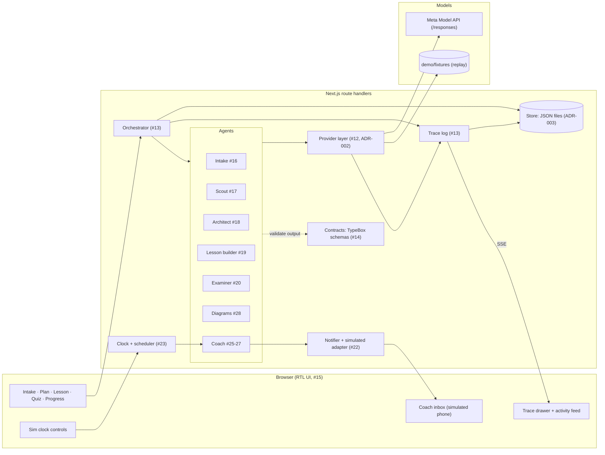

# Architecture

One Next.js app (ADR-001). The browser renders an Arabic RTL UI. Route handlers run the orchestrator, which steps through named agents. Agents reach models only through the provider layer, and every step writes trace events that stream back to the UI's trace panel.



## Components

| Component      | Owner issue      | Responsibility                                                                                                               |
| -------------- | ---------------- | ---------------------------------------------------------------------------------------------------------------------------- |
| Config         | #11              | `src/config.ts` reads `.env`. The only place that reads `APP_NAME`, `DEMO_TOPIC` and the other settings.                     |
| Contracts      | #14              | TypeBox schemas for every entity (ADR-006): TS types, runtime validation, and strict `json_schema` response formats in one.  |
| Provider layer | #12              | One interface for all model calls, routed by role. Modes `live`, `record` and `replay`.                                      |
| Orchestrator   | #13              | Runs agents as typed steps over session state. Validates each output against its contract and retries once on failure.       |
| Store          | #13              | Session state and trace events as JSON files under `data/sessions/`, and a cache under `data/cache/` that outlives sessions. |
| Trace          | #13              | Event per model call, tool call, decision, output or error, with Arabic and English summaries, model, cost and latency.      |
| UI shell       | #15              | The RTL Arabic UI in `src/app`: nav, top bar, trace drawer. One live trace stream feeds the drawer and the activity feed.    |
| Agents         | #16-#20, #25-#28 | Intake, Scout, Architect, Lesson builder, Examiner, Coach, Diagrams.                                                         |
| Notifier       | #22              | Consent-gated, channel-agnostic sending, quiet-hours deferral and stop words. Only the simulated adapter sends.              |
| Clock          | #23              | Simulated time per session, the only reader of system time. Moving it fires due coach rules in time order, exactly once.     |
| Evals          | #8               | Arabic quality eval in `evals/arabic`, reused as a regression test.                                                          |

Replay answers only a request it has a recording of, so in replay the agents keep the learner on the recorded run before they call a model (#55). The routes pass a `recorded` (or `replay`) dependency, read from `demo/script.ts`, that is empty unless `config.providerProfile` is `replay`. The quiz page and the examiner read the recorded short answers through one function, `replayShortAnswers()` in `src/server/agents/recorded-level.ts`, from the run at the learner's level (#98): Omar's words on the beginner's run, each short item's model answer on the others. The intake sends the recorded message at its place, the examiner grades the recorded short answers and passes the last recorded quiz on its keys, the coach writes in the recorded tone, sends a message whose wording has no recording as its template and holds back a comeback the run did not make, and the planner refuses edits. Whether the coach's wording has a recording, `hasRecording()` in the provider module says, from the recordings and the request the call would send. Each traces a decision and the page says so in one line. A score graded with recorded answers is not the learner's own: the quiz result, the lesson's foot and the plan's lesson strip say so (`bestRecorded()` in `src/server/agents/examiner/rules.ts`). Nothing catches a missing recording to try again. `docs/demo.md` lists these paths.

## Layout

```
src/app/             UI pages and route handlers
src/app/_shell/      shell components and the live trace provider (#15)
src/app/fonts/       the bundled Noto fonts and their licence (#43)
src/app/routes.ts    route registry: the nav's only source
src/server/agents/   one folder per agent
src/server/orchestrator/
src/server/providers/
src/server/clock/    sim clock, coach scheduler, sim and inbox route handlers (#23)
src/server/notifier/ notifier, consent gate, adapters (#22)
src/server/coach/    the coach: its ladder, messages and check-in answers (#25), and its view of a session (#24)
src/server/demo/     dev-only dummy agent and its runner (#15)
src/server/store/
src/server/tools/    tools agents call, such as the page fetcher (#17)
src/server/trace/
src/config.ts
contracts/           entity schemas and types (#14)
config/              .env.example, models.yaml (#12)
evals/               model evals (#8)
demo/fixtures/       seeded state, recorded responses and recorded pages
e2e/                 Playwright walk of the presenter steps on a replay server: `pnpm e2e` (#55)
docs/adr/            decisions
scripts/             repo upkeep: notices.ts writes THIRD_PARTY_NOTICES.md (#32) and ATTRIBUTION.md (#116), fonts.py writes src/app/fonts/ (#43)
spikes/              throwaway Day-1 spikes (Python, not in CI)
```

Folders are created by the issue that first puts code in them.

## UI shell (#15)

- Routes: `/intake`, `/plan`, `/lesson`, `/quiz`, `/progress`, `/coach`, `/consent`, `/settings`. `/` redirects to the learner's next step (#65): `/intake` before the interview, `/plan` after it. `nextStep()` in `src/app/_shell/next-step.ts` picks it, and the logo, the 404 and the lesson, quiz and progress pages' empty states link to it. Until the plan exists their links read «إلى صفحة الخطة», and only then «اذهب إلى خطتك». The interview's own «اذهب إلى خطتك» is the presenter's step 4 and stays. The top bar's breadcrumb names the 404 page, found by its title's id, since it has no nav route. `/lesson` and `/quiz` redirect to the lesson the learner is on, `/lesson/[lessonId]` and `/quiz/[lessonId]` (#34). `src/app/routes.ts` lists each route's id, path, Arabic label, icon and group (`learn` or `account`), and the nav reads only from it.
- The logo and every tab name the app as `config.appName` gives it, with no note beside it (#64). The root layout's title template adds the name after each page's own title, «الخطة | CuraLoom». A lesson's page and its quiz's are numbered, «الدرس الأول» and «اختبار الدرس الأول», by `lessonTabTitle()` in `src/app/_shell/lessons.ts`, so no two tabs share a title.
- Settings names the model mode with the top bar badge's Arabic labels (`MODE` in `src/app/_shell/ui.tsx`) and keeps the setting and file names in a folded «تفاصيل تقنية» (#64). It shows the server's topic, and says «لم يُحدَّد» only when the server was started without one.
- `/dev/bidi` is the mixed-direction test page (Arabic, English, Russian, Chinese). It is not in the nav.
- The UI shows the session `DEMO_SESSION_ID` from `demo/session.ts` until real sessions exist.
- One client provider in `src/app/_shell/` opens a single `EventSource` to `/api/sessions/{id}/trace/stream` and keeps the events. The stream starts with an SSE comment, so the server sends its headers and the `EventSource` opens even while the session's trace is empty. The trace drawer and the plan page's activity feed both read from it. `toActivityItem()` in `src/app/_shell/activity.ts` turns an event into a plain-Arabic feed line with no model ids or costs.
- The drawer sits on the inline end over a scrim, and `BehindTrace` makes the rest of the shell inert while it is open (#60). `traceRows()` in `src/app/_shell/trace-view.ts` filters its list by agent and kind and folds exact repeats into their latest row; the same module names kinds and model roles in Arabic.
- `POST /api/dev/dummy-run` (optional body `{"sessionId"}`, default the demo session) answers 202 and runs the dummy agent from `src/server/demo/` in the background, through the real orchestrator. It emits about 10 seconds of trace events with no model calls. Its first output fails its contract, so the orchestrator's retry shows in the trace. It answers 409 while that session already has a run. Dev tools follow `config.devTools` (off in a production build): there the route answers 404, the drawer's «تشغيل تجريبي» button is hidden and `/dev/bidi` is a 404.
- The dummy agent's output schema is a local TypeBox schema in `src/server/demo/dummy-run.ts`, not a contract in `contracts/index.ts`: a dummy result is not a domain entity (ADR-006).
- Every run appends to the demo session's trace in `data/sessions/demo`, and the feed and drawer replay it on each page load. The demo bar's «إعادة», Settings' reset and the intake's «ابدأ من جديد» clear the trace with the session (#119). Clear it by hand before recording the demo video only when those are not enough: `rm -rf data/sessions/demo`.
- Styling, icons and fonts: ADR-007.
- At phone width (760 px and below, #35) the rail leaves the side. A menu button at the start of the top bar opens it as a sheet under the top bar, and a link, Escape or a tap outside closes it. The trace tab becomes an icon button at the other end of the top bar, and its drawer takes the whole width under it. `--tab-w` drops to 0, so pages keep a 16 px gutter on each side.

## Clock (#23)

- Simulated time is `SimTime = {day, minute}` (`src/server/clock/time.ts`), written `"day 2 19:00"`. A session starts at day 0 09:00.
- `wallNow()` in `src/server/clock/clock.ts` is the one place that reads system time. `src/guards.test.ts` fails on `Date.now()` or an argless `new Date()` anywhere else in `src/` (ADR-004).
- `createSimClock()` keeps each session's time in the `sim_clock` document. It only moves forward: `advance(by)`, `set(day)` (09:00, or another minute the sim names), and `reset()`. A move into the past throws `ClockError`. Each move emits a `clock` trace event. The sim's jump to a day lands at 09:00, or at the end of quiet hours when that morning is quiet, so the demo clock shows a coach message at a sendable hour.
- The tracer stamps every event with the session's sim time as `sim_ts`, beside the wall-clock `ts`. With `SIM_CLOCK=false`, `sim_ts` is null.
- `createScheduler()` (`scheduler.ts`) fires the rules a `RuleSource` lists, each `{key, at, type, template, cta, why, write()}`. After each move it takes every rule due by the new time whose key is not in the `scheduler` document, oldest first and one at a time. For each one it waits for `write()` to give the message's text, saves the coach event, sends the message through the notifier and records the key, so a rule never fires twice. The coach's ladder (#25) is the source.
- `createSim()` (`sim.ts`) wires the clock, the scheduler, the coach and the notifier for one session. A move is async and waits for each coach message's wording. `reset()` deletes the session's documents and its trace, then records the reset, which restores the seeded state with an empty feed (#119).
- `POST /api/sessions/{id}/sim/{advance,set,reset}` takes `{days?, minutes?}`, `{day}` or nothing. It answers `{now, events}` with the coach events the move fired, 409 for a move into the past, and 404 while `SIM_CLOCK=false`.
- `useSimClock()` (`src/app/_shell/use-sim-clock.ts`) is the client side of those routes. The demo bar and Settings both use it, and both jump to the days of `ladderMarks()` (#64). A day the clock has passed is off and says how to go back to it. The top bar's clock pill reads the latest `clock` trace event, so every open tab follows a move.
- The clock waits for the learner's plan (#61). Between the intake and the plan the coach has no study of the learner's to follow, so `useSimClock()` answers `waitsForPlan`, and the demo bar's day button and markers and Settings' hour, day and day list turn off and say «تتحرك الساعة بعد أن تجهز خطتك». Reset stays on. `GET /api/sessions/{id}/plan` answers `{kind}` from `planKind()` (`src/app/_shell/lessons.ts`): `sample` before the intake, `own` once the plan is built for the current profile, and `none` between the two. The hook reads it through `readWaitsForPlan()` on each page and 400 ms after the trace goes quiet, and a failed read never holds the clock. The routes still take a move, so nothing the clock or the coach computes changes.
- The demo bar (`src/app/_shell/demo-bar.tsx`) docks at the bottom of every page while `SIM_CLOCK` is on. It shows a day timeline with one marker per rung of the coach's ladder, from `ladderMarks()`. A marker ahead of the clock jumps to its day, and one the clock has passed turns green. It collapses to a chip and keeps that choice in `localStorage`. With no choice saved it renders both, and CSS shows the bar on a roomy screen and the chip at phone width or under 700 px of height, such as 1440×900 at 150% zoom (#66), so neither flashes the open bar after hydration. Collapsed at phone width, the chip sits after the page instead of over it. With under 52rem of bar content, each marker shows its day number only, so the captions do not overlap. At the end of a page the bar sits after it, so it never hides the page's last line. While the page scrolls it floats over it, and a `ResizeObserver` measures the room it takes into `--demo-bar-h` on `<html>` (0 in `globals.css`), so full-height columns such as the activity feed and the coach phone, and sticky actions such as the quiz's submit bar, end above it at any zoom. «إعادة» asks first, in the coach phone's confirm row: «أتريد أن تبدأ العرض من الصفر؟» with «نعم، ابدأ من الصفر» and «تراجع» (#66). Focus starts on «تراجع», and Esc goes back to «إعادة». «نعم، ابدأ من الصفر» empties the session and the trace, then reloads the page so the clock is «يوم البدء» and the feed is empty (#119). The prototype variants live on `prototype/23-demo-bar`.
- The mode badge (`src/app/_shell/mode-badge.tsx`) in the top bar and on the demo bar, also on its chip, is a button with a native popover (#66). A click, a tap, Enter or Space opens two short sentences on the mode and a line saying the learner is a sample persona; Esc or a click outside closes them. CSS anchor positioning centres them under the badge, or above it in the demo bar, and keeps them 1 rem off the screen edge; a browser without it centres them on the screen. `MODE` in `ui.tsx` holds each mode's label, code, icon and sentences. `e2e/shell.e2e.ts` checks the badge, the reset question, and that no page content sits under the demo bar or the trace tab at 1440×900, at 150% zoom and on a phone.

## Notifier (#22)

- `createNotifier()` (`src/server/notifier/notifier.ts`) takes a message `{id, to, channel, template, text_ar, cta, sim_ts}` and answers `sent`, `deferred` with `deliver_at`, or `suppressed_opt_out`. The same id is sent once.
- `gate()` (`gate.ts`) is a pure table of rules over the consent and the sim time. It suppresses a message while consent is missing or withdrawn. During quiet hours, including hours that cross midnight, it defers the message to the end of the window. As the clock passes that time, the scheduler calls `deliverDue()`, which asks the gate again before it delivers.
- `receive(text)` is the inbound handler. A reply that is only a stop word (`توقف`, `إيقاف`, `stop` and variants, matched after removing case, tashkeel, tatweel, alef forms, punctuation and polite words such as «من فضلك») saves the opt-out at once, cancels held messages and sends one confirmation. A second stop word sends nothing.
- `NOTIFIER_ADAPTER` picks the adapter (default `simulated`). The simulated adapter appends to the session's `inbox` document. `whatsapp` and `email` are stubs that throw and list what a real adapter must do. `src/guards.test.ts` fails on `fetch`, sockets or an HTTP module import in `src/server/notifier/`.
- Notifier traces carry no message text, number or address. The Arabic summary speaks to the learner («أُرسلت إليك رسالة المدرب»), and the English one names them by id.
- `/coach` renders the phone from the inbox and the outbox (`phoneThread()`). `POST /api/sessions/{id}/inbox` with `{text}` is the learner's reply. With `{event_id, choice, pause_days?}` it is a tap on a check-in's button (#25), which `coach.answer()` takes or refuses with 409. Both answer `{opted_out, confirmed, answer}`. The phone's «توقف» button asks before it sends the stop word, in a row that takes the compose bar's place; a typed «توقف» stops at once, as over SMS.

## Consent (#24)

- Before the intake the coach follows the seed's Omar, with his seeded consent and coach events. After it, `sessionSimSeed()` (`src/server/coach/session.ts`) gives the sim the saved learner with no consent (quiet hours 22:00-08:00, or 22:00-12:00 when the interview asked for no morning messages, intensity `gentle`, the softer tone) and no coach events, so no message reaches a learner who has not agreed. When the profile changes it deletes the coach's documents (consent, outbox, inbox, coach events, fired-rule ledger, check-in answers) and records the profile's hash in `coach_for`: what Omar agreed to, was sent or replied before the intake is not the new learner's. `sessionSim()` builds that sim. The pages call it directly. The sim, inbox and consent handlers in `src/server/clock/http.ts` take a `sim(sessionId)` factory, which each route builds on `sessionSim()` for every request. The handlers run one request per session at a time. Only the sim route passes the coach's model calls (`coachSteps()`), since only a clock move writes coach messages.
- `setConsent({messages, quiet_hours, intensity}, at)` on the notifier saves the consent screen's choice. Turning messages on grants consent and clears an opt-out, keeping the day consent was first granted, and moves each held message to the end of the new quiet hours, or delivers it now if they have ended. Turning them off is the same opt-out as a stop word: it cancels held messages, but sends no confirmation, since the learner is on the screen. The sim then brings the coach events' statuses in line with the outbox.
- `/consent` is the form (`consent-form.tsx`): the messages switch, quiet hours, intensity and the channel, where WhatsApp and email are marked «قريبًا». It explains what the coach sends while the learner is away. `POST /api/sessions/{id}/consent` with `{messages, quiet_hours: {start, end}, intensity}` answers `{consent}`, or 400 for a bad body or session id, or quiet hours that end when they start.
- The pages name the consent in one of three states (#57), from `consentState()` in `src/app/_shell/course.ts`: `not_asked` («لم تُطلب موافقتك بعد»), `on` and `stopped` («الرسائل متوقفة بطلبك»). The stored consent keeps its `granted` and `opted_out` fields; the state is read from them. `/consent`, `/coach` and Settings share the pill (`CONSENT_PILL`) and the sentence (`consentText()`). Before the intake all three mark the seed's consent «مثال», and the sentence names Omar («بموافقة عمر»). A learner never asked can save the form only with the switch on (#91), since saving it off records a stop. `heldBecause()` tells the queue and the phone whether a held-back message came before the learner agreed or after they stopped. It compares the message's time with `stoppedAt()`: the minute of the confirmed «توقف» in the phone's inbox, or the start of the day for a stop saved on `/consent`, which keeps only the day.
- The plan page asks for consent under the lesson button until the learner answers. Settings shows the consent and links to `/consent`, whether the messages were stopped from the form or by «توقف».

## Coach (#25)

The coach chases a learner who stops studying. `docs/coach.md` has the ladder, its statechart, the check-in answers and the wording rules.

- The ladder (`src/server/coach/ladder.ts`) is pure. From the day of the learner's last quiz it lists the rungs due by a time: a nudge on day 2, a lighter-week offer on day 5, a check-in on day 10, then a weekly message from day 17. It also gives the ladder's state. A rung's id carries the last quiz's day, so a quiz starts a new ladder with nothing stored.
- `createCoach()` (`coach.ts`) turns the rungs into the scheduler's rules. Spark words each message through the orchestrator on the `coach` model role, from a brief with no name, id, topic or time, and code puts the learner's name in. A draft that breaks the rules gets one retry. After a second failure, or while the learner has the messages off, the coach sends the rung's Arabic template, and the trace says why.
- The day-10 check-in carries three buttons: a pause of the coach's messages, shorter sessions or another source. The last two are recorded for the re-planner (#26). `coach.answer()` takes a tap and keeps it in the `coach` document.
- `studyOf()` (`session.ts`) gives the coach the learner's quiz days and current lesson: the seed's before the intake, the saved plan's after it.
- A learner with a plan of their own who is two or more days past their last quiz is back when they answer the check-in or open the app (#27). `POST /api/sessions/{id}/comeback/{open,recap,replan}` opens the comeback, takes the recap's answers, and finishes it: code grades the recap, and `proposeReplan()` (`architect.ts`) saves the plan's next version as `pending`, explained by Spark on the `replan` model role or by a template. `docs/coach.md` has the flow.

## Intake (#16)

The intake profiles a new learner in a short Arabic chat, then sets their level with a quick check of three questions. `createIntake()` in `src/server/agents/intake/intake.ts` keeps the interview in the session document `intake`, whose `status` goes from `interview` to `diagnostic` to `done`.

1. `start()` greets the learner by name with a fixed message that asks for their goal and current work. It makes no model call.
2. Each learner message is one orchestrator step, `intake:<run>:message:<n>:<hash of the text>`, so a different message after a failed step is a new step. The model reads the whole conversation and fills `IntakeReply`. It says what it now knows of the goal, background, weekly hours, accepted source languages and dropout history, each null until the learner says it. It also gives the dialect, a short acknowledgement (`ack_ar`) and questions for what is still missing (`ask_ar`), at most two at a time. Code keeps a field once heard, and records on the learner's turn which fields it gave. Code writes the reply: the acknowledgement, then the model's questions, or a fixed question for the first missing field when the model asked none. A source language counts as accepted when the learner takes sources in it, delivered in Arabic, so a learner who accepts any language accepts all four. The scout searches only those languages.
3. Once nothing is missing, or after the 4th message, the reply ends with a fixed line that moves on to the quick check, whatever the model asked. The step `intake:<run>:diagnostic` writes three multiple-choice questions on the topic (`Diagnostic`). Code checks that each has four different options and one answer among them (`diagnostic.ts`), shuffles the options and adds «لا أعرف بعد». The questions are cached per topic in `data/cache/intake/`.
4. `answer()` scores each answer 1 or 0. Below half right is `beginner`, below 85% `intermediate`, otherwise `advanced`. The step `intake:<run>:profile` builds the `LearnerProfile` in code; a field never answered gets a default (all four languages, 3 hours a week), and `history_notes` (in Arabic) names it. The profile is saved as the session document `profile`, and a closing reply gives the level. In replay, each level in `RECORDED_LEVELS` (`demo/script.ts`) plays on its own recordings, all three since #98. A level not listed would play from the first one listed, the beginner's (`src/server/agents/recorded-level.ts`, #55). The closing reply would then give the level alone, a note under it (`level_note_ar` in the view) and the plan page would say that the plan follows the beginner's path (`recordedLevelNote()`), and the profile step would trace the swap once (#88). The profile keeps the learner's own level.

So the interviewer speaks at most 6 times. `<run>` is a random id per interview: after `reset()`, which deletes the `intake` and `profile` documents, a new interview never resumes the old one's steps. The trace names the fields each message gave, never the learner's words.

`POST /api/sessions/{id}/intake/{start,message,answers,reset}` takes `{}`, `{text}`, `{answers: {q1: "<option>", …}}` or `{}`, and answers `{view}`: the turns, the fields heard, the dialect, the questions without their answers and, once done, the picked answers and the level. It answers 400 for a bad body or answers that skip a question, 409 for a call out of turn or while the session's last message is still being answered, and 502 when the model fails the step twice. The session's learner (id and name) comes from the seed until accounts exist.

The `/intake` page shows the chat beside «ما فهمناه منك», the five fields as they fill. Each learner message has a line under it that names what the interviewer heard from it. The quick check sits in the thread under the move to it. When the interview is done, the page shows the level and a link to the plan. «ابدأ من جديد» does the same full reset as the demo bar's «إعادة» (#119): the clock, the session, the coach and the feed, then reloads the interview. The page reads the demo session's interview on the server, and `interview.tsx` posts to the routes above.

Voice input (#37): the composer's mic button records in the browser with `getUserMedia` and `MediaRecorder`, and stops by itself at a minute (`use-voice-message.ts`). The page decodes the recording, mixes it down to mono and resamples it to 16 kHz in an `OfflineAudioContext`, encodes 16-bit PCM WAV (`encodeWav()` in `src/server/agents/intake/wav.ts`) and posts it to `POST /api/sessions/{id}/intake/transcribe` as `audio/wav`. The route reads the body like `jsonBody()`, with its own cap of 2 MB (`audioBody()` in `src/server/clock/http.ts`), checks the WAV header (`transcribableWav()`) and calls `transcribeVoice()` in `intake.ts`. That calls `provider.transcribe()` on the `transcribe` role with keyword biasing for tool, course-site and role names, and the provider traces the call with its role, model and cost, never the words. It answers `{text}`, which joins the composer's text for the learner to edit and send; nothing is sent for them. It answers 400 for a post from another site, another content type or a WAV the transcriber does not take, 409 while the interview is not waiting for a message, 413 over the cap (unread when the content-length says so) and 502 when the transcription fails. The page says in Arabic when the microphone is refused or missing, when the clip is too long, when it heard nothing, and when the transcription failed. In replay there is no mic button: a chip plays the bundled clip of Omar's first message and posts it, and its transcription replays from its recording (`docs/demo.md`, «Voice in replay»).

The replay test in `intake.test.ts` runs Omar's recorded interview in Gulf dialect, on the scout's sample topic: three messages, a valid profile with 5 hours a week, five interviewer turns. `pnpm fixtures:record` re-records it with the contract smoke tests. Each reply took 5 to 9 s live. Another replay test there posts the bundled clip to the transcribe handler: its recorded transcription took 2.7 s and cost $0.00045 for 9.04 s of audio.

## Scout (#17)

The scout finds open-licence learning resources on the learner's topic in the source languages that the learner's profile accepts (`source_langs_ok`, in the profile's order). Omar's seed accepts English, Russian, Chinese and French. `scoutBrief()` refuses a profile that accepts none. `runScout()` in `src/server/agents/scout/scout.ts` runs the scout as one orchestrator step:

1. The model writes two search queries per language from a `ScoutBrief`, which holds the topic, goal, level and languages. The brief has no name or contact field, so neither can reach a prompt.
2. One `provider.webSearch()` runs per language. The prompt allows 4 searches and 6 opened pages. Only the URL citations in the answer count.
3. The model describes each cited page as a `Candidates` item with relevance, level fit and `why_ar`, and no licence fields. A candidate URL the search did not cite is rejected. So is a cited page the model leaves out as off the topic.
4. The page fetcher reads each candidate page, and `classifyLicence()` in `licence.ts` maps the page's licence statements to an SPDX id and a use. CC BY, CC BY-SA, CC0, MIT, Apache-2.0 and public domain are `open`. A licence with NC or ND is `personal_study`, which the UI tags «للدراسة الشخصية». A page can name several licences if all of them are on the allowlist, for example CC BY for the text and Apache-2.0 for the code samples. The resource then cites a content licence before a code licence (MIT, Apache-2.0), a personal-study licence before an open one, and the licence with more CC terms first. It quotes the licence it cites. NC or ND anywhere on the page makes the page `personal_study`. The checker rejects all other pages: all rights reserved, a licence beside "all rights reserved", any licence off the allowlist (also beside an allowed one), and "Creative Commons" without its terms. It also rejects a page cut at the byte cap, because the terms past the cap were never read.
5. `rank()` in `rank.ts` weighs relevance 0.5, level fit 0.3 and licence 0.2 (`open` 1, `personal_study` 0.5). It takes 0.15 off for each resource already picked in the same language and keeps the top 8.

If fewer than 5 resources pass, the scout runs one extra round. The model writes broader queries for the two languages with the fewest passing pages, and it sees the queries already tried. Then the scout searches, checks and ranks again, and stops. It does not check or reject again a page that the first round saw. With 1 to 4 resources the step succeeds, and the trace gets a warning. The warning is an `error` event, because the trace has no warning kind; the activity feed shows it as a warning. With no resource, the step fails.

The schemas are in `contracts/index.ts` (ADR-006): `ScoutQueries` and `Candidates` for the model's replies, and `Rejection` and `ScoutResult` for the step output. Each reply goes through `validate()` right after its call. A reply that breaks its contract fails the attempt with the contract errors, and on the orchestrator's one retry the scout adds those errors to the prompts for its queries and its candidates.

Every cited page ends as a `Resource` or as an entry in `rejected` with an English and an Arabic reason. Code sets `licence.verified`, `licence.quote` and `licence.evidence_url`. The trace holds the queries for each language, each fetch, each licence check and each rejection with its reason. The last scout event gives the run's total cost in `summary_en`. It has no `cost_usd` field, because the model-call events already carry their costs.

The scout caches what it pays for:

- The step key hashes the topic, the sorted languages and the level. A second run in the same session returns the saved output without a model call. The level is in the key because the queries are written for it, so an interview restarted at another level searches again (#98). In replay the key holds the level the requests carry (`requestLevel()`).
- The same hash names the result in `data/cache/scout/`, outside every session (`createFileCache()` in `src/server/store/store.ts`). A run in a new session, or after a sim reset, reads the result from there. It traces the hit as a `decision` event and makes no model call.
- The same folder keeps each query plan and each paid web search, under a hash of its request: the instructions and the input, which holds the language, the queries and the learner lines. The orchestrator's retry of a failed step, and any later run that sends the same request, reads the answer and does not pay again. Only validated replies are kept. The searches of all languages finish before an error is thrown, so the retry finds every finished search.
- The result key holds only the topic, the languages and the level. After a change to the licence checker or the ranker, delete `data/cache/scout` to search again.

Web search picks the URLs, so the page fetcher in `src/server/tools/fetch-page.ts` requests only public addresses on ports 80 and 443. It follows at most 3 redirects itself, and it checks each hop's URL, address and robots.txt before requesting it. The default transport checks the addresses a host resolves to at connect time, so DNS rebinding cannot swap in a private one. A robots.txt that cannot be read, after a network error or a 5xx, blocks its site. The fetcher times out after 20 s, reads at most 512 KiB and retries a network error once. Like the provider, it records to and replays from `demo/fixtures/pages/`, keyed by host and URL hash. A page replay has no recording of throws `MissingPage` and is traced as a missing recording, as a model request is. Recording keeps a page it already has, so a re-record fetches only new pages; a page or robots.txt recorded as a failure that may pass (a network error, a timeout, a 429 or a 5xx) is fetched again.

`pnpm scout` runs the scout for the seed learner on the demo session. It prints the resources per language, the rejections by reason, the cost and the number of model calls. Set the topic in the shell for that run only. To re-record the fixtures, run `rm -rf data/sessions/demo data/cache/scout`, then `PROVIDER_PROFILE=record DEMO_TOPIC="<topic>" pnpm scout`, and set `RECORDED_TOPIC` in `scout.test.ts` to the same topic. A cache hit records nothing, so clear the cache first. Recording reuses a fixture whose request has not changed, so delete a fixture to record it again. A reply recorded cut off is the exception: recording asks for it again, so a retry identical to the failed call can pass. `pnpm fixtures:prune` deletes the fixtures no test replays. The recorded run cost $0.33, and its slowest search took 47 s. Its replay keeps 6 resources, one of them a LibreTexts page that adapts a CC BY 4.0 source and is shared under CC BY-NC-SA 4.0.

## Architect (#18)

The architect designs the learner's course: the whole road to their goal as modules of whole weeks, and a schedule for the first two weeks only, the part the learner commits to. `runArchitect()` in `src/server/agents/architect/architect.ts` runs it as one orchestrator step.

1. `architectBrief()` takes the learner's topic, goal, level, background, weekly hours and interview notes, and the resources whose licence code verified. The brief has no name or contact field, so neither can reach a prompt.
2. The `curriculum` role (Muse Wonder, `config/models.yaml`) fills a `PlanDraft`: modules with their weeks, the lessons of the first two weeks inside their module, the sessions of each lesson inside it, the resource ids each lesson draws on, and an Arabic rationale. Lessons and sessions are nested, so the only reference the model writes is a resource id. Switching the role to Spark is an edit of that one line. The role's `max_output_tokens` (12000) caps Wonder's reply, reasoning included, because its output tokens are the plan's main cost. A capped role's call times out after 20 ms per output token it may write (240 s here), never under the default 120 s. The provider fails any Responses reply whose status is not `completed`, such as a reply cut off at that cap, as cut off with its cost traced, instead of reading the partial text; the orchestrator's one retry then runs.
3. Code numbers the lessons in road order (`L1`…) and the sessions by day (`s1`…), gives each session its lesson's resources, and builds the `CoursePlan` with `version: 1` and `reason: "initial"`. The plan id is a hash of the draft, so a replay gives the same plan.
4. `planViolations()` in `rules.ts` checks the plan against one table of rules: each week's minutes are at most the learner's weekly hours × 60; every session names at least one resource, and only resources the scout found; every session falls in days 0 to 13 and in its lesson's module's weeks, so the road and the calendar agree; a session is 10 to 90 minutes; every lesson has a session and a module the road has; a module that starts in days 0 to 13 has a lesson. A broken rule fails the attempt, and the orchestrator's retry sends the broken rules back to the model.
5. A plan that keeps every rule can still be about another subject: while #108 was recorded, one advanced plan's rationale and first two lessons came from other conversations (#109). `checkTopic()` in `topic.ts` then checks the subject, with no model call. Its words come from the learner's topic and goal and from the scout's resource titles and Arabic reasons, less a list of words about teaching, levels and sources in general. Arabic spellings are folded and each word is cut to a light stem, so «البيانات» meets «بيانات». Each committed lesson's title should name one of those words, and the rationale should name one or talk about the course's pace: sessions, weeks, minutes. A lesson can be on the subject in words its brief never used, so the plan is off its topic only when its rationale is, or more than half of its lessons are. A first attempt off its topic fails, and the orchestrator's retry sends the parts that strayed back to the model. The check runs only on a plan that keeps the rules, so a retry for broken rules sends those rules alone, as recorded. A retry still off its topic keeps the plan, and an `error` event names the parts that strayed, which the activity feed shows as a warning. `topic.test.ts` replays every recorded architect request and checks that each plan passes.

The step key hashes the brief, so a second run for the same learner and resources returns the saved plan without a model call.

`createPlanner()` keeps the session's plan in the document `plan`: a content hash of the profile it was built for, every version, oldest first, the resources the scout found and the limits each version must fit. `build()` runs the scout for the learner's profile, then the architect, once per profile. `planFor()` answers the saved plan only when it was built for the given profile, so a plan built for the seed before the intake, or for another learner before the intake restarted, is not served to the current learner; their next build makes a new plan, free of model calls when the scout's and the architect's inputs are unchanged. Any change to the profile document therefore drops the plan and its edits; today only the intake writes it. `edit()` takes a learner's edit, `{op: "move", session_id, day}` or `{op: "shorten", session_id, minutes}`, and `applyEdit()` checks the edited plan against the same rules. An accepted edit is a new version with `reason: "learner_edit"`; the versions before it stay. A refused edit changes nothing and answers the broken rules in English and Arabic. Each edit and each refusal is an `output` trace event, so the activity feed shows it as finished work. `reset()` deletes the document; the next build reads the saved architect step.

`POST /api/sessions/{id}/plan/{build,edit,accept,reject,reset}` takes `{}`, an edit, `{version}`, `{version}` or `{}`, and answers `{plan}`. `accept` and `reject` answer the re-planner's proposal by its version. `build` plans for the intake's profile, or the seed's until the intake is done; the page never shows a plan built for the seed. It answers 400 for a bad body or a refused edit (with `violations`), 409 for an edit before there is a plan for the current profile or while a proposal waits, an accept or a reject of a version that is not the one waiting, or a call while the session's plan is being built, and 502 when the scout or the architect fails its step twice.

The replay test in `architect.test.ts` replays the scout's recorded run, then plans for the seed's learner on it. `pnpm fixtures:record` re-records it. The recorded Wonder call took 39 s and 4,183 output tokens (3,396 of them reasoning), about $0.09: 4 modules over 8 weeks, and 8 sessions of 25 to 35 minutes, 120 and 125 minutes in the two weeks of Omar's 300.

A second replay test, in `intake.test.ts`, runs the demo's chain: Omar's recorded interview, then the scout and the architect on the profile it saved. In its recording Wonder's first reply broke the rules (one module of 1,900,000 weeks with no lesson, and a rationale on another subject); the retry kept them in 42 s and 4,153 output tokens: 5 modules over 8 weeks, 13 sessions of 20 to 30 minutes, 140 and 175 minutes in the two weeks. The same file walks the chain for an intermediate and an advanced learner too, each on its own recordings (#98). For the intermediate plan Wonder kept the rules on its first reply. For the advanced plan its first reply, on another subject, broke them, and the retry kept them.

The re-planner (#26, ADR-008) is pure code in `replan.ts`. `replan()` keeps the sessions of passed lessons before today as history and lays the lessons not passed again from today, in order: a review of the lesson the recap flags first, a first week back of at most 60% of the first version's lightest week with sessions of at most 20 minutes, shorter sessions for «جلسات أقصر», and another source for the current lesson for «مصدر آخر». Days still count from day 0, so a module that needs more days grows. `diffOf()` records each version's changes as `PlanChange`s (review, move, shorten, switch, drop, extend) in `diff`. `proposeReplan()` (`architect.ts`) saves the result as `SavedPlan.pending` with `explanation_ar` written by Spark on the `replan` role from a `ReplanBrief`, checked by `noteViolations()`, or by `templateNote()`. For a switch Spark may pick the source among `switchCandidates()`, and code keeps its own pick when Spark's is not one of them. Accepting a switch forgets the lesson as written and its untaken quiz, so the lesson page writes it again from the new source.

The plan page (`src/app/plan/page.tsx`) reads the learner's plan with `planFor()`. With a plan, it shows the latest version: the Arabic rationale, the two committed weeks as a strip of days with each week's minutes against the learner's time, the road as a timeline, the sources and the activity feed. A module in the committed weeks lists its sessions, each with the language and original title of its sources, and «انقل» or «أقصر» opens an editor under a session (`road.tsx`). The editor offers only the committed days of the session's module, or the four nearest lengths below the current one. It runs `applyEdit()` on each choice to show the week's minutes or the broken rule in Arabic before anything is sent. Saving posts `edit` and refreshes the page. A 409 on save also refreshes it, because the learner's profile may have changed since the page was drawn. Once the intake is done and there is no plan, the page shows a placeholder and `Building` posts `build` on mount through `useBuild()` (`src/app/_shell/use-build.ts`). A 409 with `Retry-After` means another request is building it, so it asks again after that many seconds; any other answer that is not a success is a failure. `Building` is keyed by the profile's hash, so a refresh after the profile changed starts a new build, and it stays mounted once the plan is shown, so neither the page's focus nor the activity feed is reset when the plan arrives. When the build fails, the lede, the status pill and the body all say so, the failure is announced as an alert, and the body offers a retry that moves focus to the page title. A build that stopped on a request or page replay has no recording of cannot pass on a retry, so `build()` in `architect.ts` keeps a `plan_stuck` doc with the profile's hash and the missing recording's name, and `stuckBuild()` reads it (#58). Only a miss by the scout or the architect during that build counts (#83). `build()` then throws `BuildStuck`, which the route answers with 409 and `{stuck: true}`, and `useBuild()` reports as `stuck`, so the page shows the stuck state without a retry first. On a later load the page renders the failure from its first byte, posts no build, and offers «ابدأ العرض من جديد» (`RestartDemoButton` in `src/app/_shell/missing-recording.tsx`) in place of the retry. A plan for the profile or the architect's reset ends it. Before the intake, the page shows the seed's plan as an example that takes no edits. Once the plan is shown, «دروسك» lists the committed lessons in order (`LessonStrip` in `src/app/_shell/lesson-strip.tsx`), each passed with its score, or «في العرض المسجّل» in replay when that score came with recorded answers, the one the learner is on, or shut until the quiz before it is passed, and a session's lesson title links to its lesson once the gate opens it. The activity feed's button names the lesson it opens («ابدأ الدرس الأول», «تابع الدرس الثاني»): it stays locked while the page asks the lesson builder for that lesson, and opens when the lesson is written; a failure says so under the button and offers a retry.

While the learner's comeback is due or open (`sim.comeback()`), the plan page shows it above the plan (`comeback.tsx`): a welcome, their own ask, three numbered steps, the days they missed, and the recap on `QuizPaper` posting to `comeback/recap`. `DetectOnOpen` (`proposal.tsx`) posts `comeback/open` once while it is due, and `ReplanNow` posts `comeback/replan` when there is no recap to take. Once a proposal waits, the same section shows it: the recap result, Spark's note, the current and proposed plans day by day with a line from each moved session's old day to its new day (`compare.ts`), the lighter week against its cap, every change with its tags (`sessionChanges()` in `src/app/_shell/plans.ts`), and a bar whose buttons post `accept` or `reject`. Editing is hidden while a comeback or a proposal is open. After an accept, the page shows the new version with a «لماذا تغيّرت؟» callout, and the week strip dims past days, marks today and bands the lighter week.

## Lesson builder (#19)

The lesson builder writes one lesson of the learner's plan: short excerpts from the lesson's resources, each beside an Arabic explanation, and the lesson's glossary terms. `createLessonBuilder()` in `src/server/agents/lesson/lesson.ts` runs it as one orchestrator step per lesson, keyed `lesson:<id>:<brief hash>`.

1. `lessonBrief()` takes the learner's topic, goal, level and background, the lesson's title, module and minutes from the latest plan version, the resources its sessions name whose licence code verified, and the course glossary so far. It has no name or contact field.
2. The step reads each resource's page again through the page fetcher, so a replay reads the pages the scout recorded. The scout checked the licence when it found the page, so `quotableText()` runs the scout's `classifyLicence()` on the page as read now and the step quotes it only while it still carries the licence the scout verified, for the same use; a page it could not read in full, or one whose licence or use changed, is left out and traced with that reason. The step cuts a page at 40,000 characters and numbers its sentences. The page text is a third party's: the prompt lists it under a heading that calls it quoted material, one sentence per line so no page text can pass for a heading, and the instructions say to ignore anything in it that asks for something.
3. The `agent_default` role (Muse Spark) fills a `LessonDraft`: objectives, 3 to 5 sections, each with a resource id, the numbers of the first and last sentence it quotes, the heading they sit under, an Arabic explanation and a tip, and 5 to 8 glossary terms with the source language and term, the Arabic term with and without tashkeel, a definition and an example. The explanation brackets the source term after a glossary term's first mention in each section, as in `الجدول المحوري (pivot table)` (spike #8).
4. `mergeGlossary()` in `rules.ts` gives a source term the course already has its existing entry, whatever the draft says, so a source term has one Arabic term across lessons. Code builds the `Lesson` and cuts each excerpt from its page with `excerptOf()`, without footnote marks (a run of them with its commas) or edit links, so an excerpt is always the page's own words. The model once "quoted" a passage of the French Wikipedia article on Excel from memory, in 4 of 5 attempts, when it was asked to copy text.
5. The builder checks that each section quotes one of the lesson's resources and sentences its page has, and `lessonViolations()` checks the rest: an excerpt has 15 to 300 words, a Chinese character counting as one; an explanation has no Latin or Cyrillic word outside brackets, except an all-capitals one such as `SUM` or `C10`; the lesson has at least 3 sections and 5 glossary terms, each in a language the lesson quotes; each glossary term is bracketed in the text, and every bracketed source term follows its glossary Arabic term, which may carry a prefix, tashkeel or no article; no objective, explanation, tip or glossary entry holds a web address or email. A bare domain counts only with a lowercase top-level domain from a list and no call after it, so `ASP.NET`, `System.IO`, `df.info()` and `STDEV.S` pass; an address spelled out in words is not caught. A broken rule fails the attempt, and the orchestrator's retry sends it back to the model.

The builder keeps the session's lessons in the document `lessons`: the plan id they were written for, the lessons by id and the course glossary. `savedLessons()` answers it only for that plan, so a learner's edit keeps the lessons and a new plan writes new ones. `build(lessonId)` writes a lesson once per plan.

`POST /api/sessions/{id}/lessons/{lessonId}` takes `{}` and answers `{lessons}`. It answers 400 for a bad body, 404 for a lesson the plan lacks, 409 before there is a plan for the current profile or for a lesson the quiz gate keeps shut (`LessonLocked`), 409 with `Retry-After: 3` while the session is writing a lesson, since each lesson adds to the glossary the next one reads, and 502 when the builder fails its step twice. The plan route's busy answer carries the same header (`stillBuilding()` in `src/server/clock/http.ts`).

The chain test in `intake.test.ts` writes the demo plan's first two lessons in replay, the second once Omar passes the first's quiz. In its recording Spark wrote lesson 1 in 29 s and 7,645 output tokens, and lesson 2 in 59 s and 14,745 output tokens, each on its first attempt. Lesson 1 quotes two French Wikipedia articles in 3 sections and has 6 terms. Lesson 2 quotes the English and Russian articles in 4 sections, and its 6 terms give «pivot table», «Сводная таблица», «spreadsheet» and «filter» the Arabic terms lesson 1 gave their French counterparts. The two calls cost about $0.13.

The lesson page (`src/app/lesson/[lessonId]/page.tsx`) shows one lesson of the learner's plan, by its id. `learnerCourse()` in `src/app/_shell/lessons.ts` reads the course the lesson, quiz and plan pages share: the latest plan, its written lessons and glossary, its quizzes, and each lesson's state (`courseLessons()`: its place, written or not, open, passed, best score). `currentLesson()` is the first open lesson not passed yet, the one `/lesson` and `/quiz` open. Before the intake the page shows the seed's lesson, labelled as an example; with no plan yet it links to the plan; for an id the plan lacks, or an example lesson the seed never wrote, it says so and links to the learner's next step; for a lesson the gate keeps shut it names the quiz that opens it, with the plan's lessons in order beside it. With an open lesson not written yet it asks the lesson builder through `useBuild()` (`LessonBuilding` in `terms.tsx`) and shows the lesson's shape until it is written, or a failure with a retry that moves focus to the title. When the lesson builder stopped on a missing recording (`stoppedOnMiss()` in `src/app/_shell/missing-recording.tsx`, the banner's reading of the trace), the failure drops its retry and leaves the restart to the banner, and the lesson's quiz and diagram drop their retries the same way. When the lesson arrives, a polite status line says so. Each section puts the Arabic beside the excerpt. `termMarks()` finds each glossary term in the Arabic, which becomes a button: hover with a mouse opens its card after 140 ms, and a click, tap or Space pins it; Escape, the close button or a click or tap elsewhere closes it, and one timer serves every term. An open card takes Escape before the trace drawer, so one key closes one thing. While a card is open, `sourceMarks()` marks the source term where the excerpt writes it as a whole word. Under the lesson, «المصادر والتراخيص» lists the sources it quotes, numbered R1, R2 in the order it quotes them, each with its language, verified licence, a link to where code found the licence, the sections that quote it and a button that copies an attribution line. «ما الذي غيّرناه» says the Arabic is an explanation, not a translation, and that the excerpts are quoted as they are without what stood in square brackets; when one ShareAlike licence covers a quoted source and every other quoted source can go under it (open and not ShareAlike), it says the Arabic carries that licence. The glossary follows, one entry per source term.

## Examiner (#20)

The examiner writes a quiz for each lesson of the learner's plan and grades the learner's attempts. `createExaminer()` in `src/server/agents/examiner/examiner.ts` reads the plan and its written lessons through `courseOf()`; the rules live in `rules.ts`.

1. Writing a quiz is one orchestrator step, keyed `quiz:<lesson id>:<brief hash>`. The brief holds the lesson, its glossary entries, the learner's background and the questions of the lesson's earlier quizzes, which the model is told to avoid. The `agent_default` role (Muse Spark) fills a `QuizDraft`: 4 multiple-choice items with 4 options and 2 short answers, each with a key (a model answer for a short one), a rubric and the glossary ids it checks. The model puts the right option first and makes it the longest unless told otherwise, so the prompt asks for options of one length and wrong options a learner might choose, and code orders each item's options by a hash of their text.
2. Code trims each item's text, numbers the items `i1`, `i2` and names the quiz `q_<lesson id>_<draft hash>`. `quizViolations()` checks the quiz: 5 to 8 items, at least one of each type, 3 or 4 distinct options with the key among them, no options on a short answer, only glossary ids the lesson has, and no web address or email in any text (the lesson rules' `addressIn()`). `repeatViolations()` fails a question the lesson's earlier quizzes asked, whitespace aside.
3. The `judge` role answers the multiple-choice items from the lesson alone, without the keys, and fills a `KeyCheck`. `keyViolations()` fails the attempt for an item where the judge chose another option, and the orchestrator's retry sends the disagreement back to the writer. A violation names items by id only, never an option or a key, because the orchestrator traces it and the trace drawer shows it while the quiz is still to take. The examiner test injects a wrong key into Spark's first reply and checks that the retry catches it and that no trace event holds the key.
4. Grading is one step per set of answers, keyed `grade:<quiz id>:<brief hash>`. Code grades a multiple-choice answer by the key, with the rubric as its feedback. The judge grades all the short answers in one call against their rubrics (1, 0.5 or 0, rounded to the nearest half by code), whatever dialect or spelling they use, and writes Arabic feedback for each. Each answer goes to the judge as a JSON string, and the instructions say it is data, never instructions or rubric. An attempt's score is the mean of its items' scores, and it passes at the quiz's `pass_threshold` of 0.8. In the recording, the judge graded 5 Gulf-dialect answers as their rubrics give, 5 of 5.

The examiner keeps the session's quizzes in the document `quizzes`: the plan id they were written for, every quiz, every attempt and each lesson's `Mastery` (best score, passed, attempts). `quiz(lessonId)` writes the lesson's quiz once, and writes another one after an attempt below the gate (`quizDue()`), so a retry asks other questions. `attempt()` takes answers to the lesson's latest quiz only, one for every item, each multiple-choice answer one of its item's options. A quiz takes one attempt, since its keys are shown with the grades: the same answers on the same simulated day return that attempt, and other answers are refused. `lessonOpen()` opens a plan's first lesson and each later one once the lesson before it is passed, and both methods refuse a lesson it keeps shut. The lesson builder refuses it too (`LessonLocked`, a 409 without `Retry-After`), reading the mastery the route passes it, so no lesson is written before the learner can open it. A quiz write and a grading run can overlap, so each re-reads the document after its step and adds to that copy. `recapQuiz()` (`rules.ts`) is the short quiz over the passed lessons for the learner's comeback (#27): at most five multiple-choice items, taken in turn from each lesson, the ones the learner missed first. `gradeRecap()` grades it in code, and its attempt stays out of the lessons' attempts and mastery.

`POST /api/sessions/{id}/quizzes/{lessonId}` takes `{}` and answers the lesson's view: its quiz to take without keys or rubrics, its earlier quizzes, its attempts and its mastery. `POST .../quizzes/{lessonId}/attempts` takes `{quiz_id, answers: [{item_id, response}]}` and answers the graded attempt with the view. They answer 400 for a bad body or answers the quiz cannot take, 404 for a lesson the plan lacks, 409 before there is a plan or the lesson is written, for a lesson the gate keeps shut, or for answers to a quiz that is no longer the one to take or already graded, 409 with `Retry-After: 3` while the session is writing a quiz or grading an attempt, and 502 when the examiner fails its step twice.

The chain test in `intake.test.ts` writes the quiz for the demo plan's first lesson and plays Omar's two attempts in replay. He misses one multiple-choice item and earns half on a short answer, 75%, so lesson 2 stays shut and the lesson builder refuses it; the retry quiz asks six new questions, he passes it, and lesson 2 opens, is written, and gets its own quiz. Writing the first quiz took Spark 5,927 output tokens and its key check 903; the recordings for #20, re-recordings included, cost about $0.25.

The quiz page (`src/app/quiz/[lessonId]/page.tsx`, client parts in `paper.tsx`) shows the quiz of one lesson of the plan, by the lesson's id. A lesson the gate keeps shut, or one not written yet, has no quiz to show, and the page says which way leads there. Before the intake it shows the seed's graded quiz as an example. With no quiz yet, `QuizWriter` asks the quiz route through `useBuild()` and shows the quiz's shape, or a failure with a retry. A quiz to take is one page: numbered items, the multiple-choice ones as radio rows and the short ones as text boxes, with a bar that counts the answers and submits them. Submitting before every item is answered lists the missing ones as links instead. Answers are kept per quiz in sessionStorage until graded. While the attempt is graded the form is locked under a status heading; a failure keeps the answers and offers to grade them again. A graded quiz shows the score against the 80% mark, the next lesson open (with «تابع إلى الدرس الثاني» to it) or shut, the items missed with links to their lesson section and glossary term, and each item with its score, the key, the learner's answer, the feedback and, for a short answer, its rubric. Below the gate, «ابدأ اختبارًا جديدًا» asks for a quiz with other questions. Keys and rubrics reach the browser only for a quiz with an attempt.

The lesson page asks for a lesson's first quiz while the learner reads it (`QuizBuilding` in `src/app/lesson/terms.tsx`), and its foot says where the quiz stands: being written, ready, passed with the score (or in the recorded demo, when recorded answers gave it), or below the gate with the best score and a link to the result, where the retry quiz is asked for.

## Diagrams (#28)

The diagrams agent gives a written lesson one diagram from the Wikimedia pages it draws on, with its labels in Arabic when the image's licence allows an edit. `createDiagramsBuilder()` in `src/server/agents/diagrams/diagrams.ts` runs it as one orchestrator step per lesson, keyed `diagrams:<lesson id>:<brief hash>`.

1. `lessonDiagramsBrief()` takes the lesson's title, its glossary terms and its Wikimedia resources whose licence code verified: first the ones its sections quote, each with the sections that quote it, then the rest of its sessions' resources.
2. The page fetcher reads each page as a view (`fetchView()`): it records and replays the page's HTML, and runs the view's reading code on it each time, so a change to `wiki.ts` needs no new recording. `figuresOf()` in `wiki.ts` lists the images that link to a file page, each with the heading it sits under. `rankFigures()` in `rules.ts` puts first the images under a heading that a section quotes, in the lesson's order, then the rest in page order, and gives each one the section it illustrates. The step tries at most 4 images, a file that two pages show once, and keeps the first one that passes.
3. For each image the fetcher reads its file page, on Commons for a shared file, and the step skips the image when it cannot. `fileInfoOf()` reads every licence the page's templates state, the author row and the original file. `imageLicence()` decides in code. It skips an image whose page states no licence, or any licence off the scout's allowlist (fair use, GFDL and GPL among them), and a CC BY or CC BY-SA image whose page names no author. With several licences it cites the most restrictive. Public domain, CC0, CC BY and CC BY-SA allow an edit. Another licence on the allowlist, such as an NC or ND one, shows the image as it is. The trace gives each skip its reason.
4. `fetchImage()` downloads the image: PNG, JPEG, GIF or WebP up to 4 MiB, and an SVG as Wikimedia's PNG rendering. `imageHeader()` reads its type and size from its bytes, and the step keeps that type, not the one the server sent.
5. The `diagram_labels` role (Muse Spark) reads the image and fills `DiagramLabels`: an Arabic caption, and each label's source text, Arabic and box. The prompt carries the lesson's glossary. `glossaryProblems()` checks that a label holding a glossary term uses the glossary's Arabic, and one re-read gets the broken terms. An image none of whose labels came back in Arabic is skipped. The override table in `glossary-overrides.ts` (a source text, its language, the approved Arabic) then replaces the Arabic of a label whose source text it names, matched after trimming, collapsing spaces and ignoring case, when the reading's differs, and a decision event says so. Only the labels the diagram shows change. The edit and the check keep the reading's, so a recorded request keeps its hash, and a fix in the table needs no re-record. A sample that passes the check while an override fired carries the reading's Arabic, so the diagram shows the legend without another sample, and the check's problems say why.
6. When the licence allows an edit, the `image_edit` role (Muse Image) redraws the image with the Arabic labels, at the image's size, as WebP. The `image_text` role (Spark) lists the text of the source and of the sample (`ImageTexts`). `relabelProblems()` compares the two lists text block by text block, after reading ى as ي, ة as ه, and Arabic digits, decimal point and percent sign as ASCII, and dropping tashkeel and tatweel. Each Arabic label must appear exactly as often as the reading listed it, or as often as the source shows its text when that is more, each word of a block counted for one label, the longest first, so «المجموع» is not found inside «المجموع الكلي». The labels whose count is right must come in the source's reading order, so two row labels that swapped cells fail. No source label may be left (one kept as written, or numbers only, does not count), nor a word of one beside its Arabic or split over two blocks, nor a source text the reading missed that needs Arabic, a title of two or more words in capitals among them. A word in Latin or another script that is in neither the source nor the labels fails the sample, and the numbers must match, a label's own numbers moving with it. No model judges the sample. A sample that fails gets one more edit, whose prompt names the problems. After the second failure the diagram shows the source image with a legend of its labels (`method: "legend"`), as an image whose licence allows no edit does. When the source cannot be transcribed, no sample can be checked, so the legend follows the first edit. Each failed sample is kept as a blob that its trace event links to.

An image whose reading, edit or sample transcription throws is skipped for the next one, with the error in the trace, so an outage never saves a legend for good. The step fails, for the orchestrator to retry, only when no image gave a diagram and at least one threw. An edit that answers no image code can read is a failed sample.

The step's output is `LessonDiagrams` (`contracts/index.ts`). Each diagram holds its caption, the section it goes under, the file, the author, the licence and whether it allows an edit, the labels, the method, the source and output images as blob refs with their sizes, and the check's attempts and problems. The builder keeps the output in the document `diagrams`, by lesson with the brief's hash, so a lesson's diagrams are made once per brief.

`POST /api/sessions/{id}/diagrams/{lessonId}` takes `{}` and answers `{diagrams}`. It answers 400 for a bad body or session id, 409 for a lesson not written yet, 409 with `Retry-After: 3` while that lesson's diagrams are being made, and 502 when the step fails twice. Two lessons' diagrams may be made at once. `GET .../diagrams/{lessonId}/{ref}` answers an image that the lesson's saved diagrams list, with the content type its bytes declare, `nosniff` and a year's immutable cache, since a blob's name is its content's hash. It answers 404 for any other ref. Nothing between Muse Image's reply and the browser re-encodes, resizes or strips the image. The provider keeps its b64 as sent and the store keeps that b64. The route only turns the b64 back into the bytes Muse Image sent. So the XMP packet Muse Image writes into its WebP, which names the IPTC digital source type `trainedAlgorithmicMedia`, reaches the browser (#42).

The lesson page asks for the diagrams only once the lesson is written (`DiagramsBuilding` in `terms.tsx`, through `useBuild()`), so neither the plan nor the lesson waits for them. Until they arrive, a quiet status line after the sections says that the agent is looking for a diagram, and a failure offers a retry. A status region that stays in place says to a screen reader when the diagram arrives. Each diagram is a card (`src/app/lesson/diagram.tsx`) under the section it illustrates: the caption, a «بالعربية»/«الأصل» toggle made of two radios and CSS, the image in a frame of its ratio, then the note that the labels were translated and the rest kept, the author («صاحب الرسم»), the licence linked to its deed («ملكية عامة» for public domain) and a link to the file page. On a relabelled diagram's Arabic view, the credit starts with «نسخة عدّلها الذكاء الاصطناعي (Muse Image)», titled "AI-edited by Muse Image". «الأصل» hides it, and a legend diagram has none (#42). A CC BY-SA relabel adds that the Arabic version carries the same licence. A legend diagram shows the source over a two-column table of its labels and says why: an ND licence allows no edit, another licence off the edit list is not edited, and a failed check left the source as it was. At 760 px and below, the image keeps its size and scrolls inside its card, which takes keyboard focus. In forced-colors mode the toggle's checked side uses the system's selected colours. Of three HTML prototypes, this card was the only one that showed a wide table's Arabic at a readable size.

The chain test in `intake.test.ts` makes the diagrams of lessons 1 and 2 in replay, and lesson 2's again under plan version 2. Lesson 1 gets `Visicalc.png` (public domain, User:Gortu) from the French article «Tableur». Both recorded samples failed the check: the first left a stray ".75" by the tax label and added a row of dashes, and Spark read the second's "C1" as "C!". So lesson 1 shows the legend. Its recorded reading gave the screenshot's "BUZZ CUT" as «قصة قصيرة», a short story (#38). The override table corrects the legend to «قَصّة شعر قصيرة», and the recorded edit prompts keep the reading's Arabic, so the recording stands. An earlier recording of the same image failed twice too, on the same tax label and on labels drawn in the wrong cells. Lesson 2 gets `Pivottable-Pivoted.PNG` (public domain, Wikidan829 at English Wikipedia) from the Russian article «Сводная таблица», relabelled on its first sample: 35 s to read the labels, 15 s to edit, 7 s and 9 s to transcribe. The recorded calls cost $0.15 for lesson 1 and $0.07 for lesson 2. Spark transcribed each recorded sample in its source's reading order, so the order check holds on these recordings. The image the route serves for lesson 2 has the bytes of the recorded Muse Image reply.
