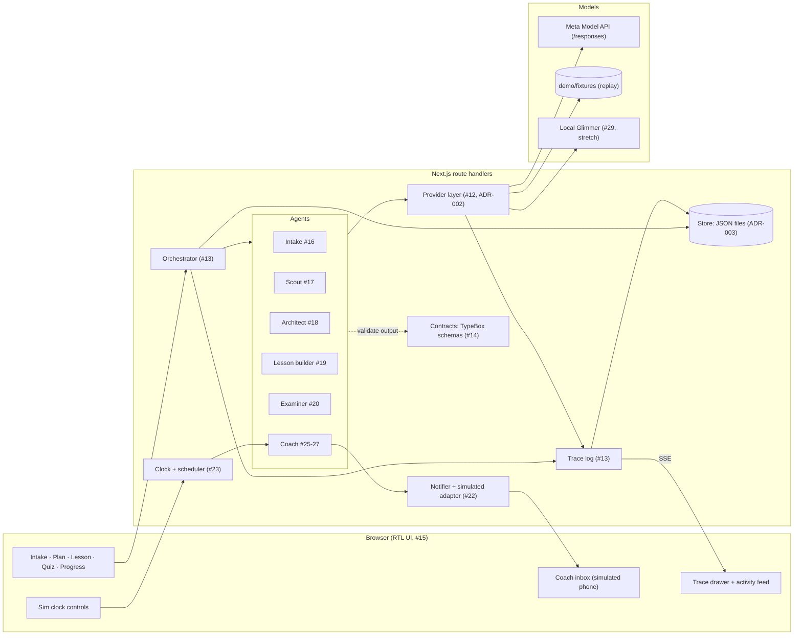

# Architecture

One Next.js app (ADR-001). The browser renders an Arabic RTL UI. Route handlers run the orchestrator, which steps through named agents. Agents reach models only through the provider layer, and every step writes trace events that stream back to the UI's trace panel.



## Components

| Component      | Owner issue      | Responsibility                                                                                                              |
| -------------- | ---------------- | --------------------------------------------------------------------------------------------------------------------------- |
| Config         | #11              | `src/config.ts` reads `.env`. The only place that reads `APP_NAME`, `DEMO_TOPIC` and the other settings.                    |
| Contracts      | #14              | TypeBox schemas for every entity (ADR-006): TS types, runtime validation, and strict `json_schema` response formats in one. |
| Provider layer | #12              | One interface for all model calls, routed by role. Modes `live`, `record` and `replay`.                                     |
| Orchestrator   | #13              | Runs agents as typed steps over session state. Validates each output against its contract and retries once on failure.      |
| Store          | #13              | Session state and trace events as JSON files under `data/`.                                                                 |
| Trace          | #13              | Event per model call, tool call, decision, output or error, with Arabic and English summaries, model, cost and latency.     |
| UI shell       | #15              | The RTL Arabic UI in `src/app`: nav, top bar, trace drawer. One live trace stream feeds the drawer and the activity feed.   |
| Agents         | #16-#20, #25-#27 | Intake, Scout, Architect, Lesson builder, Examiner, Coach.                                                                  |
| Notifier       | #22              | Consent-gated, channel-agnostic sending. Simulated adapter only.                                                            |
| Clock          | #23              | Injectable time. Fast-forwarding fires due coach events in order, exactly once.                                             |
| Evals          | #8               | Arabic quality eval in `evals/arabic`, reused as a regression test.                                                         |

## Layout

```
src/app/             UI pages and route handlers
src/app/_shell/      shell components and the live trace provider (#15)
src/app/routes.ts    route registry: the nav's only source
src/server/agents/   one folder per agent
src/server/orchestrator/
src/server/providers/
src/server/coach/    coach, notifier, clock
src/server/demo/     dev-only dummy agent and its runner (#15)
src/server/store/
src/server/trace/
src/config.ts
contracts/           entity schemas and types (#14)
config/              .env.example, models.yaml (#12)
evals/               model evals (#8)
demo/fixtures/       seeded state and recorded responses
docs/adr/            decisions
spikes/              throwaway Day-1 spikes (Python, not in CI)
```

Folders are created by the issue that first puts code in them.

## UI shell (#15)

- Routes: `/intake`, `/plan`, `/lesson`, `/quiz`, `/progress`, `/coach`, `/consent`, `/settings`. `/` redirects to `/plan`. `src/app/routes.ts` lists each route's id, path, Arabic label, icon and group (`learn` or `account`), and the nav reads only from it.
- `/dev/bidi` is the mixed-direction test page (Arabic, English, Russian, Chinese). It is not in the nav.
- The UI shows the session `DEMO_SESSION_ID` from `demo/session.ts` until real sessions exist.
- One client provider in `src/app/_shell/` opens a single `EventSource` to `/api/sessions/{id}/trace/stream` and keeps the events. The trace drawer and the plan page's activity feed both read from it. `toActivityItem()` in `src/app/_shell/activity.ts` turns an event into a plain-Arabic feed line with no model ids or costs.
- `POST /api/dev/dummy-run` (optional body `{"sessionId"}`, default the demo session) answers 202 and runs the dummy agent from `src/server/demo/` in the background, through the real orchestrator. It emits about 10 seconds of trace events with no model calls. Its first output fails its contract, so the orchestrator's retry shows in the trace. It answers 409 while that session already has a run. Dev tools follow `config.devTools` (off in a production build): there the route answers 404, the drawer's «تشغيل تجريبي» button is hidden and `/dev/bidi` is a 404.
- The dummy agent's output schema is a local TypeBox schema in `src/server/demo/dummy-run.ts`, not a contract in `contracts/index.ts`: a dummy result is not a domain entity (ADR-006).
- Every run appends to the demo session's trace in `data/sessions/demo`, and the feed and drawer replay it on each page load. Reset it before recording the demo video: `rm -rf data/sessions/demo`.
- Styling, icons and fonts: ADR-007.
