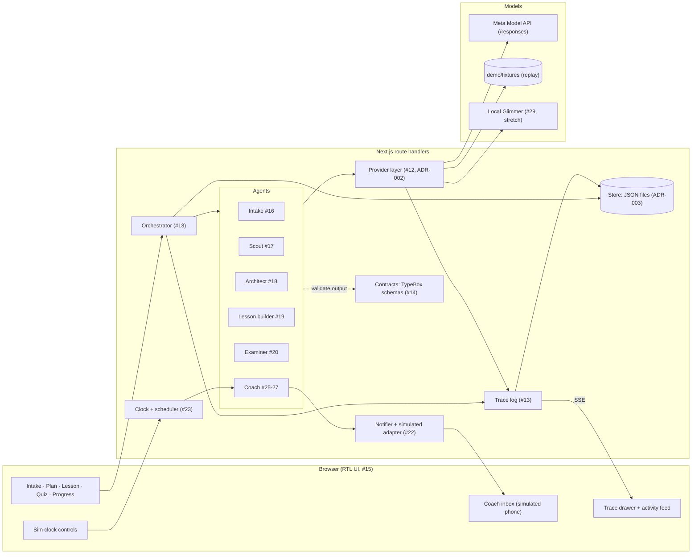

# Architecture

One Next.js app (ADR-001). The browser renders an Arabic RTL UI. Route handlers run the orchestrator, which steps through named agents. Agents reach models only through the provider layer, and every step writes trace events that stream back to the UI's trace panel.



## Components

| Component      | Owner issue      | Responsibility                                                                                                               |
| -------------- | ---------------- | ---------------------------------------------------------------------------------------------------------------------------- |
| Config         | #11              | `src/config.ts` reads `.env`. The only place that reads `APP_NAME`, `DEMO_TOPIC` and the other settings.                     |
| Contracts      | #14              | TypeBox schemas for every entity (ADR-006): TS types, runtime validation, and strict `json_schema` response formats in one.  |
| Provider layer | #12              | One interface for all model calls, routed by role. Modes `live`, `record` and `replay`.                                      |
| Orchestrator   | #13              | Runs agents as typed steps over session state. Validates each output against its contract and retries once on failure.       |
| Store          | #13              | Session state and trace events as JSON files under `data/sessions/`, and a cache under `data/cache/` that outlives sessions. |
| Trace          | #13              | Event per model call, tool call, decision, output or error, with Arabic and English summaries, model, cost and latency.      |
| UI shell       | #15              | The RTL Arabic UI in `src/app`: nav, top bar, trace drawer. One live trace stream feeds the drawer and the activity feed.    |
| Agents         | #16-#20, #25-#27 | Intake, Scout, Architect, Lesson builder, Examiner, Coach.                                                                   |
| Notifier       | #22              | Consent-gated, channel-agnostic sending, quiet-hours deferral and stop words. Only the simulated adapter sends.              |
| Clock          | #23              | Simulated time per session, the only reader of system time. Moving it fires due coach rules in time order, exactly once.     |
| Evals          | #8               | Arabic quality eval in `evals/arabic`, reused as a regression test.                                                          |

## Layout

```
src/app/             UI pages and route handlers
src/app/_shell/      shell components and the live trace provider (#15)
src/app/routes.ts    route registry: the nav's only source
src/server/agents/   one folder per agent
src/server/orchestrator/
src/server/providers/
src/server/clock/    sim clock, coach scheduler, sim and inbox route handlers (#23)
src/server/notifier/ notifier, consent gate, adapters (#22)
src/server/demo/     dev-only dummy agent and its runner (#15)
src/server/store/
src/server/tools/    tools agents call, such as the page fetcher (#17)
src/server/trace/
src/config.ts
contracts/           entity schemas and types (#14)
config/              .env.example, models.yaml (#12)
evals/               model evals (#8)
demo/fixtures/       seeded state, recorded responses and recorded pages
docs/adr/            decisions
spikes/              throwaway Day-1 spikes (Python, not in CI)
```

Folders are created by the issue that first puts code in them.

## UI shell (#15)

- Routes: `/intake`, `/plan`, `/lesson`, `/quiz`, `/progress`, `/coach`, `/consent`, `/settings`. `/` redirects to `/plan`. `src/app/routes.ts` lists each route's id, path, Arabic label, icon and group (`learn` or `account`), and the nav reads only from it.
- `/dev/bidi` is the mixed-direction test page (Arabic, English, Russian, Chinese). It is not in the nav.
- The UI shows the session `DEMO_SESSION_ID` from `demo/session.ts` until real sessions exist.
- One client provider in `src/app/_shell/` opens a single `EventSource` to `/api/sessions/{id}/trace/stream` and keeps the events. The trace drawer and the plan page's activity feed both read from it. `toActivityItem()` in `src/app/_shell/activity.ts` turns an event into a plain-Arabic feed line with no model ids or costs.
- `POST /api/dev/dummy-run` (optional body `{"sessionId"}`, default the demo session) answers 202 and runs the dummy agent from `src/server/demo/` in the background, through the real orchestrator. It emits about 10 seconds of trace events with no model calls. Its first output fails its contract, so the orchestrator's retry shows in the trace. It answers 409 while that session already has a run. Dev tools follow `config.devTools` (off in a production build): there the route answers 404, the drawer's «تشغيل تجريبي» button is hidden and `/dev/bidi` is a 404.
- The dummy agent's output schema is a local TypeBox schema in `src/server/demo/dummy-run.ts`, not a contract in `contracts/index.ts`: a dummy result is not a domain entity (ADR-006).
- Every run appends to the demo session's trace in `data/sessions/demo`, and the feed and drawer replay it on each page load. Settings' reset keeps the trace. Clear it before recording the demo video: `rm -rf data/sessions/demo`.
- Styling, icons and fonts: ADR-007.

## Clock (#23)

- Simulated time is `SimTime = {day, minute}` (`src/server/clock/time.ts`), written `"day 2 19:00"`. A session starts at day 0 09:00.
- `wallNow()` in `src/server/clock/clock.ts` is the one place that reads system time. `src/guards.test.ts` fails on `Date.now()` or an argless `new Date()` anywhere else in `src/` (ADR-004).
- `createSimClock()` keeps each session's time in the `sim_clock` document. It only moves forward: `advance(by)`, `set(day)` to 09:00 of that day, and `reset()`. A move into the past throws `ClockError`. Each move emits a `clock` trace event.
- The tracer stamps every event with the session's sim time as `sim_ts`, beside the wall-clock `ts`. With `SIM_CLOCK=false`, `sim_ts` is null.
- `createScheduler()` (`scheduler.ts`) holds a rule table `{key, at, type, fire(ctx)}`. After each move it fires every rule due by the new time, in time order, and records its key in the `scheduler` document so a rule never fires twice. The rules for days 2, 5, 10 and 17 are placeholders with Arabic template text until the coach (#25) owns them.
- `createSim()` (`sim.ts`) wires the clock, scheduler and notifier for one session. `reset()` deletes the session's documents (the trace stays), which restores the seeded state.
- `POST /api/sessions/{id}/sim/{advance,set,reset}` takes `{days?, minutes?}`, `{day}` or nothing. It answers `{now, events}` with the coach events the move fired, 409 for a move into the past, and 404 while `SIM_CLOCK=false`.
- `useSimClock()` (`src/app/_shell/use-sim-clock.ts`) is the client side of those routes. The demo bar and Settings both use it. The top bar's clock pill reads the latest `clock` trace event, so every open tab follows a move.
- The demo bar (`src/app/_shell/demo-bar.tsx`) docks at the bottom of every page while `SIM_CLOCK` is on. It shows a day timeline with one marker per coach rule. A marker ahead of the clock jumps to its day, and one the clock has passed turns green. It collapses to a chip and keeps that choice in `localStorage`. While it is open or collapsed it sets `html[data-demo-bar]`, and `--demo-bar-h` (`globals.css`) lets full-height columns such as the activity feed and the coach phone end above it. The prototype variants live on `prototype/23-demo-bar`.

## Notifier (#22)

- `createNotifier()` (`src/server/notifier/notifier.ts`) takes a message `{id, to, channel, template, text_ar, cta, sim_ts}` and answers `sent`, `deferred` with `deliver_at`, or `suppressed_opt_out`. The same id is sent once.
- `gate()` (`gate.ts`) is a pure table of rules over the consent and the sim time. It suppresses a message while consent is missing or withdrawn. During quiet hours, including hours that cross midnight, it defers the message to the end of the window. As the clock passes that time, the scheduler calls `deliverDue()`, which asks the gate again before it delivers.
- `receive(text)` is the inbound handler. A reply that is only a stop word (`توقف`, `إيقاف`, `stop` and variants, matched after removing case, tashkeel, tatweel, alef forms, punctuation and polite words such as «من فضلك») saves the opt-out at once, cancels held messages and sends one confirmation. A second stop word sends nothing.
- `NOTIFIER_ADAPTER` picks the adapter (default `simulated`). The simulated adapter appends to the session's `inbox` document. `whatsapp` and `email` are stubs that throw and list what a real adapter must do. `src/guards.test.ts` fails on `fetch`, sockets or an HTTP module import in `src/server/notifier/`.
- Notifier traces name the learner by id only, never by number or address, and carry no message text.
- `/coach` renders the phone from the inbox and the outbox (`phoneThread()`). `POST /api/sessions/{id}/inbox` with `{text}` is the learner's reply and answers `{opted_out, confirmed}`.

## Intake (#16)

The intake profiles a new learner in a short Arabic chat, then sets their level with a quick check of three questions. `createIntake()` in `src/server/agents/intake/intake.ts` keeps the interview in the session document `intake`, whose `status` goes from `interview` to `diagnostic` to `done`.

1. `start()` greets the learner by name with a fixed message that asks for their goal and current work. It makes no model call.
2. Each learner message is one orchestrator step, `intake:<run>:message:<n>:<hash of the text>`, so a different message after a failed step is a new step. The model reads the whole conversation and fills `IntakeReply`. It says what it now knows of the goal, background, weekly hours, accepted source languages and dropout history, each null until the learner says it. It also gives the dialect, a short acknowledgement (`ack_ar`) and questions for what is still missing (`ask_ar`), at most two at a time. Code keeps a field once heard, and records on the learner's turn which fields it gave. Code writes the reply: the acknowledgement, then the model's questions, or a fixed question for the first missing field when the model asked none. A source language counts as accepted when the learner takes sources in it, delivered in Arabic, so a learner who accepts any language accepts all four. The scout searches only those languages.
3. Once nothing is missing, or after the 4th message, the reply ends with a fixed line that moves on to the quick check, whatever the model asked. The step `intake:<run>:diagnostic` writes three multiple-choice questions on the topic (`Diagnostic`). Code checks that each has four different options and one answer among them (`diagnostic.ts`), shuffles the options and adds «لا أعرف بعد». The questions are cached per topic in `data/cache/intake/`.
4. `answer()` scores each answer 1 or 0. Below half right is `beginner`, below 85% `intermediate`, otherwise `advanced`. The step `intake:<run>:profile` builds the `LearnerProfile` in code; a field never answered gets a default (all four languages, 3 hours a week), and `history_notes` (in Arabic) names it. The profile is saved as the session document `profile`, and a closing reply gives the level.

So the interviewer speaks at most 6 times. `<run>` is a random id per interview: after `reset()`, which deletes the `intake` and `profile` documents, a new interview never resumes the old one's steps. The trace names the fields each message gave, never the learner's words.

`POST /api/sessions/{id}/intake/{start,message,answers,reset}` takes `{}`, `{text}`, `{answers: {q1: "<option>", …}}` or `{}`, and answers `{view}`: the turns, the fields heard, the dialect, the questions without their answers and, once done, the picked answers and the level. It answers 400 for a bad body or answers that skip a question, 409 for a call out of turn or while the session's last message is still being answered, and 502 when the model fails the step twice. The session's learner (id and name) comes from the seed until accounts exist.

The `/intake` page shows the chat beside «ما فهمناه منك», the five fields as they fill. Each learner message has a line under it that names what the interviewer heard from it. The quick check sits in the thread under the move to it. When the interview is done, the page shows the level and a link to the plan. «ابدأ من جديد» resets the interview. The page reads the demo session's interview on the server, and `interview.tsx` posts to the routes above.

Voice input (Muse Voice Transcribe) is not built; the issue makes it optional.

The replay test in `intake.test.ts` runs Omar's recorded interview in Gulf dialect, on the scout's sample topic: three messages, a valid profile with 5 hours a week, five interviewer turns. `pnpm fixtures:record` re-records it with the contract smoke tests. Each reply took 5 to 9 s live.

## Scout (#17)

The scout finds open-licence learning resources on the learner's topic in the source languages that the learner's profile accepts (`source_langs_ok`, in the profile's order). Omar's seed accepts English, Russian, Chinese and French. `scoutBrief()` refuses a profile that accepts none. `runScout()` in `src/server/agents/scout/scout.ts` runs the scout as one orchestrator step:

1. The model writes two search queries per language from a `ScoutBrief`, which holds the topic, goal, level and languages. The brief has no name or contact field, so neither can reach a prompt.
2. One `provider.webSearch()` runs per language. The prompt allows 4 searches and 6 opened pages. Only the URL citations in the answer count.
3. The model describes each cited page as a `Candidates` item with relevance, level fit and `why_ar`, and no licence fields. A candidate URL the search did not cite is rejected. So is a cited page the model leaves out as off the topic.
4. The page fetcher reads each candidate page, and `classifyLicence()` in `licence.ts` maps the page's licence statements to an SPDX id and a use. CC BY, CC BY-SA, CC0, MIT, Apache-2.0 and public domain are `open`. A licence with NC or ND is `personal_study`, which the UI tags «للدراسة الشخصية». A page can name several licences if all of them are on the allowlist, for example CC BY for the text and Apache-2.0 for the code samples. The resource then cites a content licence before a code licence (MIT, Apache-2.0), a personal-study licence before an open one, and the licence with more CC terms first. It quotes the licence it cites. NC or ND anywhere on the page makes the page `personal_study`. The checker rejects all other pages: all rights reserved, a licence beside "all rights reserved", any licence off the allowlist (also beside an allowed one), and "Creative Commons" without its terms. It also rejects a page cut at the byte cap, because the terms past the cap were never read.
5. `rank()` in `rank.ts` weighs relevance 0.5, level fit 0.3 and licence 0.2 (`open` 1, `personal_study` 0.5). It takes 0.15 off for each resource already picked in the same language and keeps the top 8.

If fewer than 5 resources pass, the scout runs one extra round. The model writes broader queries for the two languages with the fewest passing pages, and it sees the queries already tried. Then the scout searches, checks and ranks again, and stops. It does not check or reject again a page that the first round saw. With 1 to 4 resources the step succeeds, and the trace gets a warning. The warning is an `error` event, because the trace has no warning kind; the activity feed shows it as a warning. With no resource, the step fails.

The schemas are in `contracts/index.ts` (ADR-006): `ScoutQueries` and `Candidates` for the model's replies, and `Rejection` and `ScoutResult` for the step output. Each reply goes through `validate()` right after its call. A reply that breaks its contract fails the attempt with the contract errors, and on the orchestrator's one retry the scout adds those errors to the prompts for its queries and its candidates.

Every cited page ends as a `Resource` or as an entry in `rejected` with an English and an Arabic reason. Code sets `licence.verified`, `licence.quote` and `licence.evidence_url`. The trace holds the queries for each language, each fetch, each licence check and each rejection with its reason. The last scout event gives the run's total cost in `summary_en`. It has no `cost_usd` field, because the model-call events already carry their costs.

The scout caches what it pays for:

- The step key hashes the topic and the sorted languages. A second run in the same session returns the saved output without a model call.
- The same hash names the result in `data/cache/scout/`, outside every session (`createFileCache()` in `src/server/store/store.ts`). A run in a new session, or after a sim reset, reads the result from there. It traces the hit as a `decision` event and makes no model call.
- The same folder keeps each query plan and each paid web search, under a hash of its request: the instructions and the input, which holds the language, the queries and the learner lines. The orchestrator's retry of a failed step, and any later run that sends the same request, reads the answer and does not pay again. Only validated replies are kept. The searches of all languages finish before an error is thrown, so the retry finds every finished search.
- The result key holds only the topic and the languages. After a change to the licence checker or the ranker, delete `data/cache/scout` to search again.

Web search picks the URLs, so the page fetcher in `src/server/tools/fetch-page.ts` requests only public addresses on ports 80 and 443. It follows at most 3 redirects itself, and it checks each hop's URL, address and robots.txt before requesting it. The default transport checks the addresses a host resolves to at connect time, so DNS rebinding cannot swap in a private one. A robots.txt that cannot be read, after a network error or a 5xx, blocks its site. The fetcher times out after 20 s, reads at most 512 KiB and retries a network error once. Like the provider, it records to and replays from `demo/fixtures/pages/`, keyed by host and URL hash.

`pnpm scout` runs the scout for the seed learner on the demo session. It prints the resources per language, the rejections by reason, the cost and the number of model calls. Set the topic in the shell for that run only. To re-record the fixtures, run `rm -rf data/sessions/demo data/cache/scout`, then `PROVIDER_PROFILE=record DEMO_TOPIC="<topic>" pnpm scout`, and set `RECORDED_TOPIC` in `scout.test.ts` to the same topic. A cache hit records nothing, so clear the cache first. Recording reuses a fixture whose request has not changed, so delete a fixture to record it again. `pnpm fixtures:prune` deletes the fixtures no test replays. The recorded run cost $0.33, and its slowest search took 47 s. Its replay keeps 6 resources, one of them a LibreTexts page that adapts a CC BY 4.0 source and is shared under CC BY-NC-SA 4.0.

## Architect (#18)

The architect designs the learner's course: the whole road to their goal as modules of whole weeks, and a schedule for the first two weeks only, the part the learner commits to. `runArchitect()` in `src/server/agents/architect/architect.ts` runs it as one orchestrator step.

1. `architectBrief()` takes the learner's topic, goal, level, background, weekly hours and interview notes, and the resources whose licence code verified. The brief has no name or contact field, so neither can reach a prompt.
2. The `curriculum` role (Muse Wonder, `config/models.yaml`) fills a `PlanDraft`: modules with their weeks, the lessons of the first two weeks inside their module, the sessions of each lesson inside it, the resource ids each lesson draws on, and an Arabic rationale. Lessons and sessions are nested, so the only reference the model writes is a resource id. Switching the role to Spark is an edit of that one line. The role's `max_output_tokens` (8000) caps Wonder's reply, reasoning included, because its output tokens are the plan's main cost.
3. Code numbers the lessons in road order (`L1`…) and the sessions by day (`s1`…), gives each session its lesson's resources, and builds the `CoursePlan` with `version: 1` and `reason: "initial"`. The plan id is a hash of the draft, so a replay gives the same plan.
4. `planViolations()` in `rules.ts` checks the plan against one table of rules: each week's minutes are at most the learner's weekly hours × 60; every session names at least one resource, and only resources the scout found; every session falls in days 0 to 13 and in its lesson's module's weeks, so the road and the calendar agree; a session is 10 to 90 minutes; every lesson has a session and a module the road has. A broken rule fails the attempt, and the orchestrator's retry sends the broken rules back to the model.

The step key hashes the brief, so a second run for the same learner and resources returns the saved plan without a model call.

`createPlanner()` keeps the session's plan in the document `plan`: a content hash of the profile it was built for, every version, oldest first, the resources the scout found and the limits each version must fit. `build()` runs the scout for the learner's profile, then the architect, once per profile. `planFor()` answers the saved plan only when it was built for the given profile, so a plan built for the seed before the intake, or for another learner before the intake restarted, is not served to the current learner; their next build makes a new plan, free of model calls when the scout's and the architect's inputs are unchanged. Any change to the profile document therefore drops the plan and its edits; today only the intake writes it. `edit()` takes a learner's edit, `{op: "move", session_id, day}` or `{op: "shorten", session_id, minutes}`, and `applyEdit()` checks the edited plan against the same rules. An accepted edit is a new version with `reason: "learner_edit"`; the versions before it stay. A refused edit changes nothing and answers the broken rules in English and Arabic. Each edit and each refusal is an `output` trace event, so the activity feed shows it as finished work. `reset()` deletes the document; the next build reads the saved architect step.

`POST /api/sessions/{id}/plan/{build,edit,reset}` takes `{}`, an edit or `{}`, and answers `{plan}`. `build` plans for the intake's profile, or the seed's until the intake is done; the page never shows a plan built for the seed. It answers 400 for a bad body or a refused edit (with `violations`), 409 for an edit before there is a plan for the current profile, or a call while the session's plan is being built, and 502 when the scout or the architect fails its step twice.

The replay test in `architect.test.ts` replays the scout's recorded run, then plans for the seed's learner on it. `pnpm fixtures:record` re-records it. The recorded Wonder call took 78 s and 6,889 output tokens (5,945 of them reasoning), about $0.14: 5 modules over 7 weeks, and 12 sessions of 25 to 30 minutes, 165 and 175 minutes in the two weeks of Omar's 300.

The plan page (`src/app/plan/page.tsx`) reads the learner's plan with `planFor()`. With a plan, it shows the latest version: the Arabic rationale, the two committed weeks as a strip of days with each week's minutes against the learner's time, the road as a timeline, the sources and the activity feed. A module in the committed weeks lists its sessions, and «انقل» or «أقصر» opens an editor under a session (`road.tsx`). The editor offers only the committed days of the session's module, or the four nearest lengths below the current one. It runs `applyEdit()` on each choice to show the week's minutes or the broken rule in Arabic before anything is sent. Saving posts `edit` and refreshes the page. Once the intake is done and there is no plan, the page shows a placeholder and `BuildPlan` posts `build` on mount; a 409 means another request is building it, so it asks again every 3 s. Before the intake, the page shows the seed's plan as an example that takes no edits.
