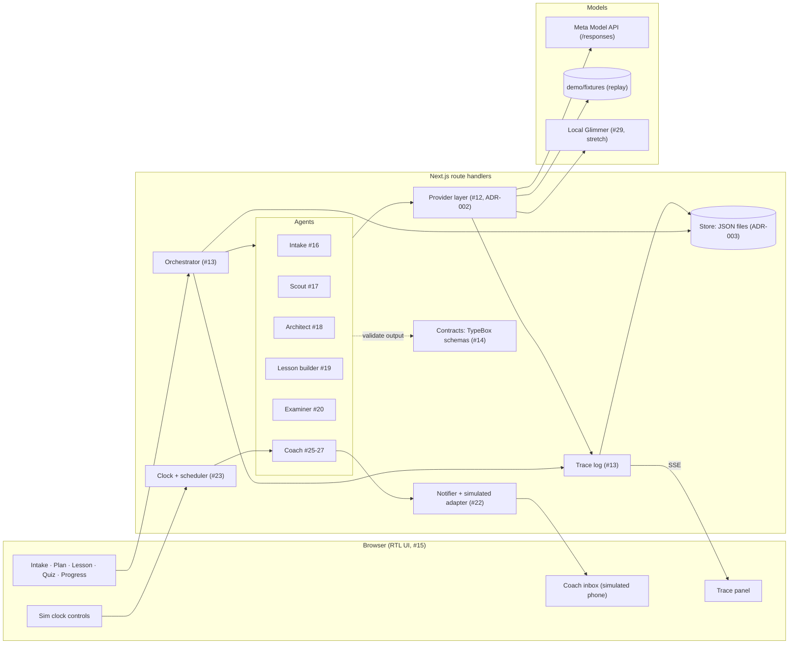

# Architecture

One Next.js app (ADR-001). The browser renders an Arabic RTL UI. Route handlers run the orchestrator, which steps through named agents. Agents reach models only through the provider layer, and every step writes trace events that stream back to the UI's trace panel.



## Components

| Component      | Owner issue      | Responsibility                                                                                                              |
| -------------- | ---------------- | --------------------------------------------------------------------------------------------------------------------------- |
| Config         | #11              | `src/config.ts` reads `.env`. The only place that reads `APP_NAME`, `DEMO_TOPIC` and the other settings.                    |
| Contracts      | #14              | TypeBox schemas for every entity (ADR-006): TS types, runtime validation, and strict `json_schema` response formats in one. |
| Provider layer | #12              | One interface for all model calls, routed by role. Modes `live`, `record` and `replay`.                                     |
| Orchestrator   | #13              | Runs agents as typed steps over session state. Validates each output against its contract and retries once on failure.      |
| Store          | #13              | Session state and trace events as JSON files under `data/`.                                                                 |
| Trace          | #13              | Event per model call, tool call, decision, output or error, with Arabic and English summaries, model, cost and latency.     |
| Agents         | #16-#20, #25-#27 | Intake, Scout, Architect, Lesson builder, Examiner, Coach.                                                                  |
| Notifier       | #22              | Consent-gated, channel-agnostic sending. Simulated adapter only.                                                            |
| Clock          | #23              | Injectable time. Fast-forwarding fires due coach events in order, exactly once.                                             |
| Evals          | #8               | Arabic quality eval in `evals/arabic`, reused as a regression test.                                                         |

## Layout

```
src/app/             UI pages and route handlers
src/server/agents/   one folder per agent
src/server/providers/
src/server/coach/    coach, notifier, clock
src/server/store/
src/server/trace/
src/config.ts
contracts/           entity schemas and types (#14)
config/              .env.example, models.yaml (#12)
evals/               model evals (#8)
demo/fixtures/       seeded state and recorded responses
docs/adr/            decisions
spikes/              throwaway Day-1 spikes (Python, not in CI)
```

Folders are created by the issue that first puts code in them.
