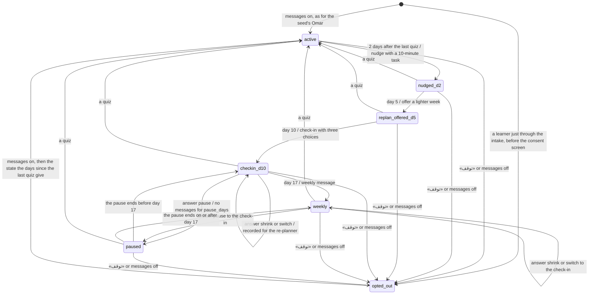

# Coach (#25)

The coach follows a learner who stops studying. It counts the days since their last quiz and sends one message at each rung of a ladder until they take a quiz again, pause the coach or stop its messages. Code decides when a message goes, what it offers and whether the learner may get it. The model only words it.

The code is in `src/server/coach/`. `ladder.ts` is pure and holds the rungs and the states. `coach.ts` turns the rungs into the scheduler's rules, words each message and takes the learner's answers. `session.ts` builds a session's coach from the store.

## The ladder

The anchor is the day of the learner's last quiz, or day 0 before any quiz. Each rung falls due at 09:00 of a day counted from the anchor.

| Rung     | Due                            | Event type | Button                                        | State after         |
| -------- | ------------------------------ | ---------- | --------------------------------------------- | ------------------- |
| `d2`     | anchor + 2                     | `nudge`    | «ابدأ مهمة ١٠ دقائق» opens the current lesson | `nudged_d2`         |
| `d5`     | anchor + 5                     | `replan`   | «افتح خطتي» opens the plan                    | `replan_offered_d5` |
| `d10`    | anchor + 10                    | `checkin`  | three choices: pause, shrink, switch          | `checkin_d10`       |
| `weekly` | anchor + 17, then every 7 days | `weekly`   | «مراجعة قصيرة» opens the current lesson       | `weekly`            |

How the rungs fire:

- A rung's id is `<type>_a<anchor>_d<day>`, for example `checkin_a0_d10`. The id is both the scheduler's ledger key and the coach event's id, so each rung fires once.
- A lesson button is left out while the learner has no current lesson.
- `rungsThrough(facts, upTo)` lists the rungs due by a time, oldest first. `ladderAt(facts, now)` says where the ladder stands.
- Nothing about the ladder is stored. A quiz moves the anchor, so the next rungs have new ids and the ladder starts again. The `coach` document keeps only the learner's answers and the last anchor the coach saw. When the clock next moves, `observe()` traces the reset once. A finished comeback moves the anchor too (see Comeback).
- The scheduler fires due rungs in time order, one at a time, and waits for each message's wording. A jump of the clock to day 24 fires all five rungs, each traced at its own time.
- The notifier holds a rung for quiet hours as it holds any message.
- The demo bar's markers come from `ladderMarks()`: the rungs of a learner whose last quiz was on day 0, as for the seed's Omar and a learner just through the intake.

## States

`ladderAt()` takes the first rule that applies:

1. Messages off, because the learner never agreed, sent «توقف» or turned them off, gives `opted_out`.
2. A pause that covers now gives `paused`.
3. Otherwise the state is the one of the last rung reached, counting rungs the pause held back, or `active` before the first.

- A finished comeback moves the anchor as a quiz does, so each edge marked "a quiz" is also taken by a finished comeback.
- While messages are off, rungs still fire. The notifier records each one as `suppressed_opt_out`, and the phone shows «لم تُرسل». A rung fired while messages were off is not sent later.
- Turning messages back on returns the ladder to the state the facts give, which can be a rung's state or `paused`, not only `active`.
- A quiz while messages are off keeps the state `opted_out`, and moves the anchor.

## Answers to the check-in

The check-in shows three buttons on the phone once it is delivered. A tap posts `{event_id, choice, pause_days?}` to `POST /api/sessions/{id}/inbox`, and `coach.answer()` takes it. It answers 409 for a message the learner has not received, a message that does not offer that choice, a check-in answered already, or a learner with the messages off.

A taken answer shows on the phone as the learner's reply. The coach acts on it, saves it in the `coach` document and sends an acknowledgement through the notifier, so quiet hours hold the acknowledgement too.

- `pause` stops the coach's messages from the answer until 09:00 of the day `pause_days` later (7 by default, 1 to 30). A rung inside the pause never fires. The pause belongs to the anchor it was chosen at, so a quiz ends it.
- `shrink` and `switch` are recorded, with the anchor they belong to, for the re-planner (#26). Neither changes the plan. For a learner with a plan of their own, the answer starts their comeback (#27), and the acknowledgement asks them to open their plan for a short recap, with an «افتح خطتي» button. The seed's Omar has no plan of his own, so his acknowledgement says only that the choice is recorded, and carries no button.

An answer to the check-in of an earlier anchor answers 409.

An answer is not activity, so the weekly messages go on after a shrink or a switch.

## Comeback

A learner with a plan of their own is back after a break when they are two or more days past their anchor and they reply (a shrink or switch answer, or free text other than a stop word) or open the app. `coach.detect()` saves a comeback record for the anchor, once, and traces `comeback_detected`. Opening the app posts `POST /api/sessions/{id}/comeback/open` with `{}` while the comeback view says `due`, the only write tied to opening the app.

- `comeback/recap` takes `{quiz_id, answers: [{item_id, response}]}` for the recap the view shows. Code grades it. Below 80% the lesson with the most misses gets a review first.
- `comeback/replan` takes `{}` and finishes a comeback with no recap, for a learner who has passed no lesson yet.
- Finishing calls the re-planner with the reason (the check-in answer, else the day-5 offer if it was sent, else the return), the day and the recap. It saves the proposal as the plan's `pending` version and sets the anchor to today, so the ladder is `active` again and the next rung is the nudge two days later.
- Spark explains the proposal through the orchestrator step `replan:v<n>:<hash of the brief>` on the `replan` model role. The brief holds the change's facts, the recap's band and the interview's notes, with no name, learner id or score. `noteViolations()` refuses a note with no Arabic, over 400 characters, with an address, a brace or an emoji, with a number the brief does not give, or with a resource the brief does not offer. After one retry, the template explains it, and the trace says why.
- A switch moves the current lesson to a verified resource it does not use yet. `switchCandidates()` ranks them by score, an open licence before a personal-study one, then by id. The brief offers them to Spark, which picks one as `resource_id`, and code lays the plan again with Spark's pick. With the template, code keeps its first candidate. The trace names the resource and who picked it.
- Accepting a version that switched a lesson forgets the lesson as written and its quiz not yet taken (`forgetLessonAndQuiz()`), so the lesson page writes the lesson again from the new resource. Its attempts and mastery stay, and so does the glossary.
- The routes answer 404 for an unknown action, 400 for a bad body or answers the recap cannot take, and 409 when no comeback is due, for a recap that is no longer the one shown, for a recap when no lesson is passed, or for `replan` while a recap is possible. They run one at a time per session.

## Wording

Spark words each message. `coachWriter` runs as an orchestrator step with the key `coach:<rung id>:<hash of the brief>` on the `coach` model role (`config/models.yaml`, reasoning `low`). It fills `CoachDraft`, `{message_ar}`.

- The brief (`CoachBrief`) gives the rung, the days since the last quiz, the tone the learner chose, the current lesson's title, the template and, for the check-in, the three choices in order. Only the day-2 nudge gets the best quiz score and the gate. The brief holds no name, id, topic or time, so a recording fits any learner at the same place on the ladder.
- The model writes `{name}` where the learner's name goes, and code puts the name in.
- `draftViolations()` refuses a draft with no Arabic, with `{name}` other than once, with any other brace, with a web or email address, with an emoji, or longer than 160 characters for the `gentle` tone or 260 for `normal`. The orchestrator asks once more with the reasons. If that draft fails too, the coach sends the template and traces why.
- A learner with the messages off gets the template with no model call, and the trace says so.
- A coach built with `steps: null` sends every template. The pages and the inbox and consent routes build it that way, since they never move the clock. The sim route passes `coachSteps()`, whose provider calls time out after 30 seconds.
- Every coach trace names the learner by id only and holds no message text.

`coach.test.ts` replays the seed's Omar to day 24 in both tones. `intake.test.ts` replays the learner the intake saved to the day-10 check-in and a shrink or a switch. Re-record both with `pnpm fixtures:record`. In `replay`, a brief with no recording gets the template.

## Not built yet

- The screens for the comeback: the card on the plan page, the recap and the proposal panel. The API above is built.
- Messages held for quiet hours are not withdrawn when the learner comes back.
