# Spike: Arabic labels on diagrams with Muse Image and SAM (#9)

**Decision: GO with Muse Image edits.** Spark 1.3 reads and translates every label. Muse Image 1.0 then redraws the diagram with the Arabic labels through `/images/edits`. On 4 diagrams with English, Chinese and Russian labels, all 12 samples have joined, right-to-left Arabic and keep every number. 10 samples pass all four of my checks, and 2 have one small slip each. A Spark transcript checked in code catches the slip that matters. The SVG overlay does not work as a general fallback, because it was clean on only 1 diagram of 4. SAM 3.1 found no text in the English and Russian diagrams, so #28 does not need it.

## Question

Can #28 show a diagram from a source in English, Chinese or Russian with its labels in Arabic, using only Meta models? Which path should it build: Muse Image edits, or an SVG overlay drawn over boxes from SAM 3.1? What does one relabelled diagram cost?

## Sources

All four allow derivatives. Each page on Wikimedia Commons records the licence.

| Id | Diagram | Labels | Author | Licence |
|---|---|---|---|---|
| `pivot` | [Pivot table: sum of units by region and ship date](https://commons.wikimedia.org/wiki/File:Pivottable-Pivoted.PNG) | English | Wikidan829, later version by Jbarta (English Wikipedia) | Public domain |
| `flat` | [Source data of that pivot table](https://commons.wikimedia.org/wiki/File:Pivottable-Flatdata.png) | English | Wikidan829 (English Wikipedia) | Public domain |
| `etl` | [ETL basic flow (ETL基本流程)](https://commons.wikimedia.org/wiki/File:ETL%E5%9F%BA%E6%9C%AC%E6%B5%81%E7%A8%8B.png) | Chinese | Aywstc | CC BY-SA 4.0 |
| `dwh` | [Data warehouse and data marts overview](https://commons.wikimedia.org/wiki/File:Data_Warehouse_and_Data_Mart_overview-rus.svg) | Russian | MarsJson | CC BY-SA 4.0 |

`pivot` and `flat` fit the demo topic, Excel pivot tables. `etl` carries a faint "WPS Mind" watermark from the tool that drew it. `dwh` is the 1280 px PNG that Commons renders from the SVG.

The relabelled `etl` and `dwh` images in `img/` are adaptations. They stay under CC BY-SA 4.0 with the attribution above. The only change is to the labels, which Meta models translated into Arabic. The `pivot` and `flat` adaptations are public domain like their sources. #28 must carry the same attribution and licence on every relabelled image it shows.

## Method

The script is [`spikes/image_arabic/relabel.py`](../../spikes/image_arabic/relabel.py). Run it from the repo root:

```sh
uv run --with requests --with pillow --with meta-sam-parser spikes/image_arabic/relabel.py
```

It caches every API response in `spikes/image_arabic/out/cache/`, so a rerun spends nothing. It writes the evidence images to [`img/`](img/), the results to [`image-arabic.results.json`](image-arabic.results.json) and one trace event per model call to [`image-arabic.trace.jsonl`](image-arabic.trace.jsonl). It asserts that the key appears in neither file. Each diagram goes through these steps.

1. **Working image.** The script upscales a source whose long side is under 1000 px by a whole factor, with Lanczos. `pivot` goes from 558×137 to 1116×274, `flat` from 475×222 to 1425×666 and `etl` from 575×668 to 1150×1336. `dwh` stays 1280×822.
2. **Spark reads.** One `muse-spark-1.3` call on `/responses` with the image and a strict JSON schema. It returns every label with its source text, a short Arabic translation and a box on Spark's 0 to 1000 grid. The prompt carries the demo glossary (pivot table, sum, row, column, data) and tells Spark to skip numbers, dates and acronyms. Spark found every label on all 4 diagrams, which have 9, 40, 9 and 22 labels.
3. **SAM segments.** The script makes two kinds of `sam-3.1` call. First, nine concept prompts per diagram: `text`, `text label`, `word`, `words`, `label`, `letter`, `character`, `writing` and `caption`. Then box prompts seeded by Spark's boxes, at most 16 boxes per call.
4. **Muse Image edits.** One `muse-image-1.0` call on `/images/edits` with the working image and a prompt that lists each unique `"source" -> "Arabic"` pair. The prompt says to change nothing else. A second call asks for 2 more samples (`n: 2`) of the same request.
5. **SVG overlay.** For each label, a rectangle in the label's background colour and the Arabic text in Noto Sans Arabic, `direction: rtl`, sized to the box. Headless Chrome renders it to PNG. Three variants use three sets of boxes: Spark's boxes, SAM's box-prompt boxes, and the best box per label (a SAM concept box when one exists, else Spark's box snapped to the ink).
6. **Two automatic checks.** Each candidate image gets both.
   - Spark as a judge: one Spark call with the source and the candidate side by side. It lists every problem it sees and returns `pass`.
   - Spark as a transcriber: one Spark call per image lists every piece of text in it, numbers included. Code then compares the candidate's transcript with the expected Arabic labels and with the source's transcript (`compare_transcripts` in the script).

I scored every output myself by viewing it at full size. Each score is four booleans.

- `joining_ok`: every Arabic letter joins as it should.
- `rtl_ok`: every label reads right to left, with words in the right order.
- `spelling_ok`: every label reads as the expected Arabic, complete and unclipped.
- `layout_ok`: labels sit where the source labels were, nothing overlaps, no source text is left, and every line, shape, number and date is unchanged.

## Results

### Muse Image edits

`/images/edits` takes a JSON body: `model`, `prompt`, `images: [{"image_url": "data:image/png;base64,..."}]`, `n`, `size` and `output_format`. The output keeps the aspect ratio of `size` but not its pixel count. All outputs here were 2.1 to 2.5 megapixels: `pivot` came back at 2928×720 and `dwh` at 1968×1264.

| Diagram | Source | Muse Image |
|---|---|---|
| `pivot` | 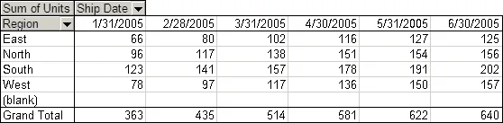 | 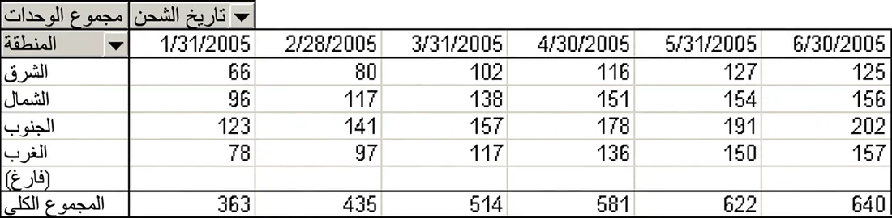 |
| `flat` | 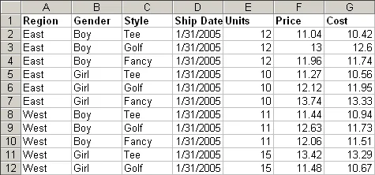 | 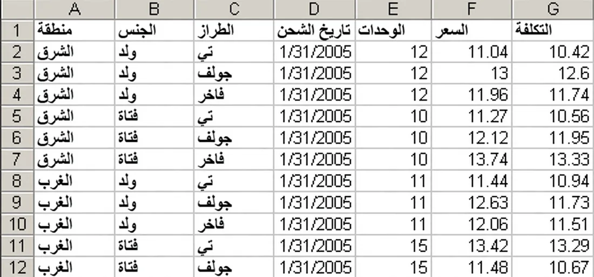 |
| `etl` | 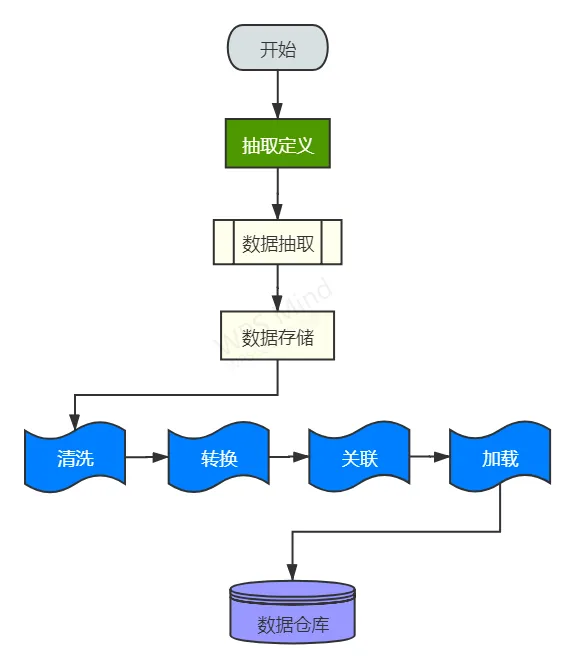 | 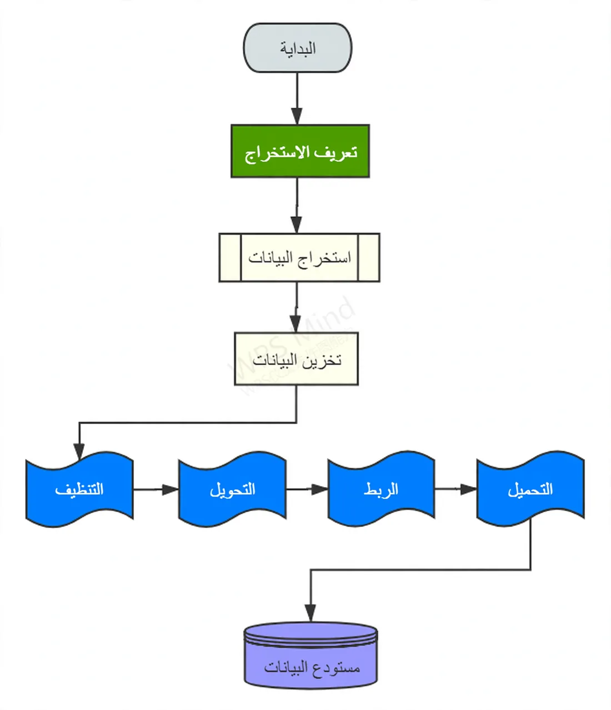 |
| `dwh` | 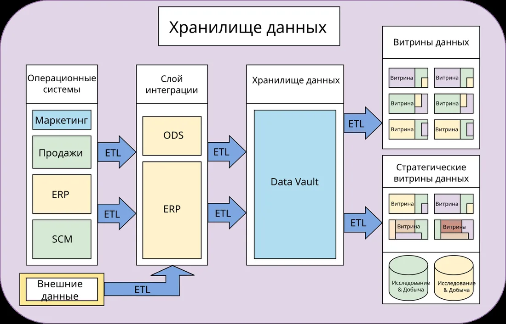 | 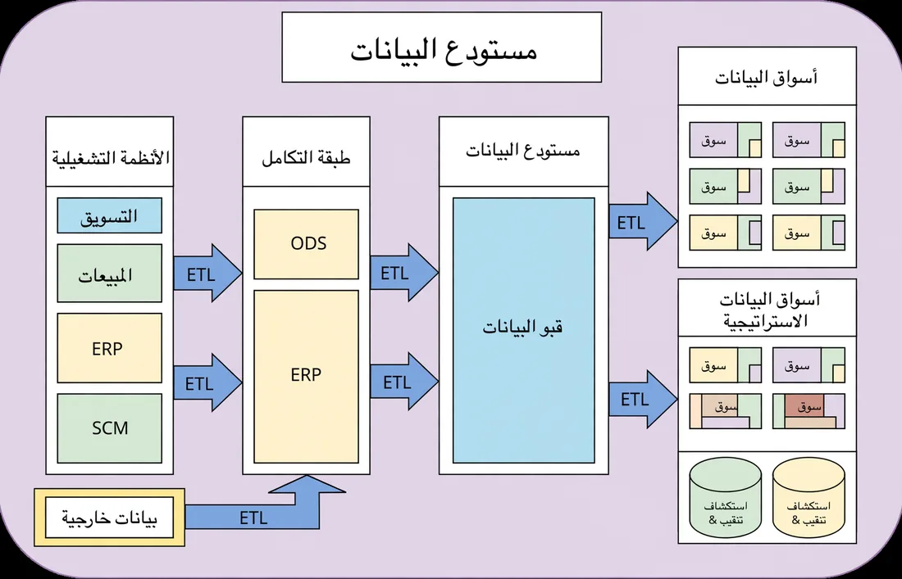 |

The two extra samples per diagram are in `img/<id>-muse-repeats.webp`.

```json
{
  "muse_image": {
    "pivot": {"joining_ok": true, "rtl_ok": true, "spelling_ok": true, "layout_ok": true},
    "flat": {"joining_ok": true, "rtl_ok": true, "spelling_ok": true, "layout_ok": true},
    "etl": {"joining_ok": true, "rtl_ok": true, "spelling_ok": true, "layout_ok": true},
    "dwh": {"joining_ok": true, "rtl_ok": true, "spelling_ok": false, "layout_ok": true}
  },
  "muse_image_repeats": {
    "pivot_1": {"joining_ok": true, "rtl_ok": true, "spelling_ok": true, "layout_ok": true},
    "pivot_2": {"joining_ok": true, "rtl_ok": true, "spelling_ok": true, "layout_ok": true},
    "flat_1": {"joining_ok": true, "rtl_ok": true, "spelling_ok": true, "layout_ok": false},
    "flat_2": {"joining_ok": true, "rtl_ok": true, "spelling_ok": true, "layout_ok": true},
    "etl_1": {"joining_ok": true, "rtl_ok": true, "spelling_ok": true, "layout_ok": true},
    "etl_2": {"joining_ok": true, "rtl_ok": true, "spelling_ok": true, "layout_ok": true},
    "dwh_1": {"joining_ok": true, "rtl_ok": true, "spelling_ok": true, "layout_ok": true},
    "dwh_2": {"joining_ok": true, "rtl_ok": true, "spelling_ok": true, "layout_ok": true}
  }
}
```

These are the differences I found against the source.

- Every number, date and acronym (ETL, ODS, ERP, SCM) is unchanged in all 12 samples. So is every arrow and shape, apart from the row in `flat` repeat 1.
- In the `dwh` main sample, "استكشاف وتنقيب" came out as "استكشاف" over "& تنقيب". Muse kept the `&` from the Russian source instead of the requested "و". Every other label in that sample is exact.
- In `flat` repeat 1, row 5 is taller than the other rows, and its numbers sit lower in their cells.
- The main `pivot` sample right-aligns the row labels, as an Arabic spreadsheet would, and moves the Ship Date dropdown arrow to the left of its label. The other table samples keep the source's left alignment.
- In the `flat` main sample, the body labels are bold. The source has them regular.
- In all three `pivot` samples, "(blank)" became "(فارغ)" with brackets that look like braces.
- `etl` repeat 2 removed the faint "WPS Mind" watermark. The other two `etl` samples keep it.

### SVG overlay

| Diagram | Best boxes |
|---|---|
| `pivot` | 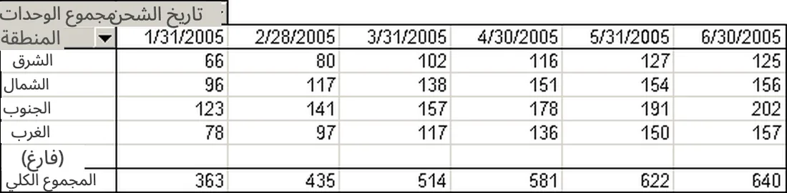 |
| `flat` | 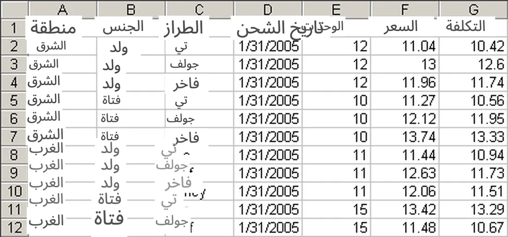 |
| `etl` | 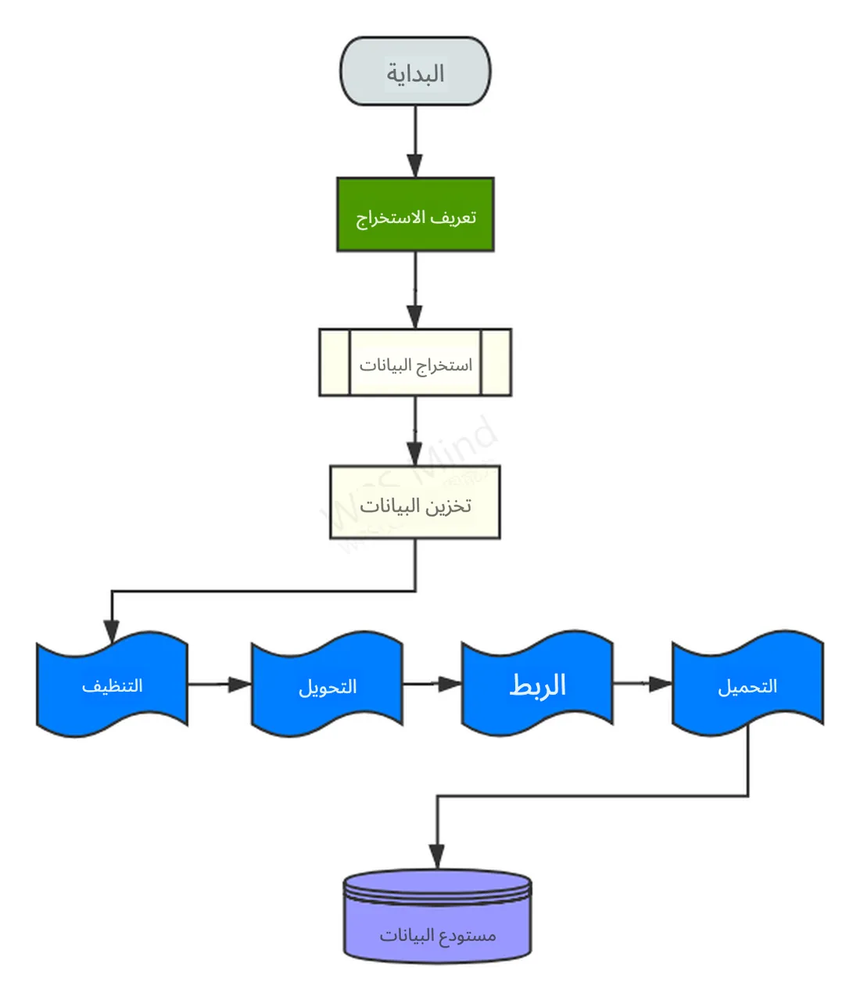 |
| `dwh` | 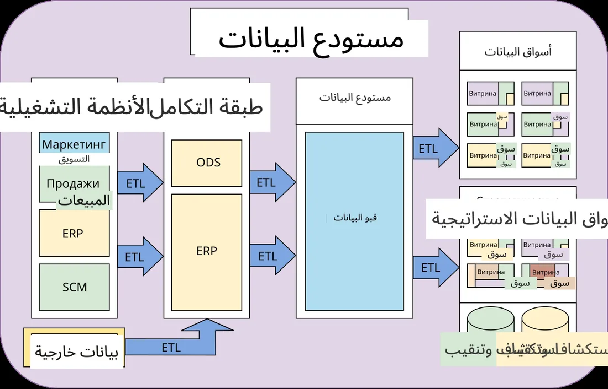 |

The variants with Spark's raw boxes and with SAM's box-prompt boxes are in `img/<id>-svg-spark.webp` and `img/<id>-svg-sam.webp`. Neither is better than the best boxes.

```json
{
  "svg_overlay": {
    "pivot": {"joining_ok": true, "rtl_ok": true, "spelling_ok": true, "layout_ok": false},
    "flat": {"joining_ok": true, "rtl_ok": true, "spelling_ok": false, "layout_ok": false},
    "etl": {"joining_ok": true, "rtl_ok": true, "spelling_ok": true, "layout_ok": true},
    "dwh": {"joining_ok": true, "rtl_ok": true, "spelling_ok": false, "layout_ok": false}
  }
}
```

Chrome shapes Arabic correctly, so joining and direction are never the problem. Placement is. The overlay is only as good as the boxes, and the boxes drift.

- `pivot`: the two header labels run into each other, and the white-out covers the Ship Date dropdown arrow.
- `flat`: Spark's boxes for the Style column sit about 28 px to the right of the text. Rows 8 to 12 keep fragments of the English, and the Arabic Ship Date label half covers "الوحدات".
- `etl`: clean. SAM's `word` boxes are tight on Chinese text. "الربط" is drawn larger than its neighbours because its box is taller.
- `dwh`: titles overflow their boxes and overlap, and the image edge clips "أسواق البيانات الاستراتيجية". "سوق" lands beside each "Витрина" instead of on it, so the Russian stays. The two "استكشاف وتنقيب" labels overlap each other.

### SAM 3.1

**Concept prompts do not find text in diagrams.** All 9 phrases returned 0 matches on `pivot`, `flat` and `dwh`. On `etl`, `word` found all 9 Chinese labels with tight boxes (confidence 0.61 to 0.64), and the other 8 phrases found nothing. The controls show the requests are well formed.

| Image | Prompt | Matches |
|---|---|---|
| Photo of an apple | `apple` | 1 |
| Photo of a street sign | `text` | 0 |
| Photo of a street sign | `street sign` | 1 |
| Photo of a street sign | `letter` | 23 |
| `dwh` | `rectangle` | 25 |
| `dwh` | `arrow` | 7 |
| `dwh` | `cylinder` | 2 |

In these tests SAM 3.1 segmented shapes and, on a photo, single letters. It had no concept for a text label. It grouped Chinese characters as a `word`, but not Latin or Cyrillic letters.

**Box prompts follow the box they are given.** Seeded with Spark's boxes, SAM returned one record per box on every diagram (9, 40, 9 and 22 records in 7 calls). The masks fill the label's cell or shape, not the glyphs, as `img/<id>-masks.webp` shows. The returned boxes are a little larger than Spark's, with a median IoU of 0.67 against Spark's box. When Spark's box is off, SAM's box is off by the same amount. So box prompts cannot correct Spark's grounding.

**Parsing.** The box part of SAM's output needs no library. [`spikes/image_arabic/sam_tokens.py`](../../spikes/image_arabic/sam_tokens.py) reads it with two regular expressions, and [`test_sam_tokens.py`](../../spikes/image_arabic/test_sam_tokens.py) checks it against the sample in Meta's docs. Mask payloads use a lossless range coder of about 540 lines. Meta publishes decoders as `meta-sam-parser` on PyPI and `@meta-sam/parser` on npm, under the SAM License, which requires shipping a copy of the licence with any redistribution. The spike decodes masks with the Python package to draw them.

### Spark grounding

Spark's boxes drift, as `img/<id>-boxes.webp` shows. On `flat`, the Style column boxes sit about 28 px (2 percent of the width) to the right of the text. On `etl`, the boxes for the four wave-shaped labels sit about one box height too low. The drift does not matter for Muse Image, which takes only the text pairs. The drift is what breaks the SVG overlay.

### Checking the output automatically

#28 cannot show a learner an image nobody checked, so the spike tried two automatic checks on all 16 candidates (12 Muse samples and 4 overlays) and compared them with my scores.

**Spark as a judge does not work on Muse output.** The judge sees the source and the candidate side by side and lists problems. It agreed with me on all 4 overlays. On the 12 Muse samples it rejected 5 that have no defect, each time claiming the Arabic letters are "isolated" or "disconnected" when they are joined. It caught the kept `&` in `dwh` but missed the taller row in `flat` repeat 1. A gate that rejects half the good images is not usable.

**A Spark transcript checked in code works for text.** The code fails a candidate when an expected Arabic label is missing, when a source label is still there, or when the numbers differ from the source's transcript. It agreed with me on 11 of the 12 Muse samples. It failed the `dwh` main sample for the missing "استكشاف وتنقيب", which is the real defect. It passed `flat` repeat 1, because a taller row is not a text error. Before matching, the code folds ى into ي and drops tashkeel and tatweel. Without that fold, `pivot` repeat 2 failed because Spark read the dotted ي in "الكلي" as ى.

The transcript check does not see layout. It passed the `pivot` and `flat` overlays, whose text is all there but overlapping. That is acceptable for Muse output, where every layout change I found was cosmetic: a taller row, bold labels and a removed watermark. It would not be enough to gate the SVG overlay.

| Candidate | My score | Spark judge | Transcript check |
|---|---|---|---|
| 10 Muse samples that pass all four of my checks | pass | 5 pass, 5 fail | 10 pass |
| `dwh` main, kept `&` | fail | fail | fail |
| `flat` repeat 1, taller row | fail (layout) | pass | pass |
| `pivot` overlay | fail (layout) | fail | pass |
| `flat` overlay | fail | fail | pass |
| `etl` overlay | pass | pass | pass |
| `dwh` overlay | fail | fail | fail |

## Cost and latency

All runs were on 2026-10-31 from Cairo. Costs come from each response's usage and the prices in `config/models.yaml`. Latency is the wall time of one HTTP call.

| Call | Model | Cost per call | Latency |
|---|---|---|---|
| Read and translate labels | Spark 1.3 | $0.0097 to $0.0294 | 9 to 28 s |
| Edit the image, `n: 1` | Muse Image 1.0 | $0.01 | 12 to 32 s |
| Transcribe the source | Spark 1.3 | $0.0057 to $0.0274 | 5 to 28 s |
| Transcribe a Muse sample | Spark 1.3 | $0.0090 to $0.0375 | 9 to 39 s |
| Judge a candidate (rejected) | Spark 1.3 | $0.0118 to $0.0525 | 10 to 48 s |
| Concept or box prompt | SAM 3.1 | $0.0025 | 1 to 3 s |

One relabelled and checked diagram (read, edit, two transcripts) cost $0.037 (`pivot`), $0.040 (`etl`), $0.057 (`flat`) and $0.102 (`dwh`). The two Spark transcript calls are most of it, and they grow with the amount of text. Muse Image is a flat $0.01. Run end to end, one diagram takes 34 to 90 s, so #28 must relabel when a course is built, not while a learner waits. A retry adds one edit and one transcript, about $0.02 to $0.05.

The whole spike spent $1.27 over 117 calls. Every call is cached in `spikes/image_arabic/out/cache/`, and `image-arabic.results.json` records the cost of each call in the final run.

## Decision

**GO with Muse Image edits.** These results decide it.

- All 12 Muse samples have correct joining and direction, across English, Chinese and Russian sources. 10 pass all four of my checks. The `dwh` main sample kept one `&`, and both `dwh` repeats got that label right, so one retry fixes it.
- Muse takes only the text pairs and needs no boxes, so Spark's grounding drift never reaches the output.
- A Spark transcript checked in code catches the text errors. Spark as a judge does not.
- The SVG overlay was clean on 1 diagram of 4. It needs exact boxes for every label, and neither Spark nor SAM gives exact boxes for Latin or Cyrillic text.

I rejected the SVG overlay as the fallback. When a Muse sample fails the check twice, #28 should show the source image with a two-column legend of source label and Arabic label beside it. The legend reuses Spark's label list and needs no boxes. No sample in this spike needed it.

## What #28 should build

Build these steps for each diagram, when the course is built.

1. **Check the licence first.** Relabel only CC0, public domain, CC BY and CC BY-SA images. Never edit an ND or NC image. Show it unchanged with the legend instead. Carry the author, the licence and "labels translated into Arabic" on every relabelled image, and keep CC BY-SA adaptations under CC BY-SA.
2. **Read and translate with Spark.** Use one Spark 1.3 call through `provider.structured`, with `SPARK_PROMPT` from the script and the image as an `input_image` item. Turn `LABEL_SCHEMA` into a contract in `contracts/index.ts`. Put the course glossary in the prompt. Without it, Spark wrote "Region" as "المنطقة" on one diagram and "منطقة" on the other, and it transliterated the style "Tee" as "تي". The spike upscaled sources with a long side under 1000 px. It did not test smaller inputs.
3. **Edit with Muse Image.** Use one `imageEdit` call with `MUSE_PROMPT` and the unique label pairs. `imageEditRequest` in `src/server/providers/meta.ts` sends no `size` and no `output_format`. Add both. The spike always sent `size` as the working image's width and height and asked for PNG. The output comes back at 2.1 to 2.5 megapixels, so scale it down to display it.
4. **Check the text in code.** Transcribe the source and the Muse sample with Spark, then compare them the way `compare_transcripts` does. Fold ى into ي and drop tashkeel and tatweel before matching. The spike counts substrings in the joined transcript. #28 should match text blocks instead, so that a short label such as "تي" cannot match inside a longer word. Do not use Spark as a judge.
5. **Retry once, then fall back.** If the check fails, request one more sample and check it. If that also fails, show the source with the legend.
6. **Trace every call.** That is 4 model calls per diagram (Spark, Muse, two Spark transcripts) and 6 with a retry. The source transcript does not depend on the edit, so it can run in parallel with step 3.

**SAM 3.1 has no job in this path.** It found no text on the English and Russian diagrams, and its box prompts only repeat the boxes Spark gives them. #28's acceptance criteria ask for a trace that shows a three-model pipeline with SAM. That criterion is a product call for Ahmed. My default is to drop SAM from #28 and count Spark and Muse Image. If the demo must show SAM, one box-prompt call per 16 labels, seeded with Spark's boxes, can outline the label regions in the trace view for $0.0025. It changes nothing in the relabelled image. For that, port the box parser in `sam_tokens.py`, two regular expressions with tests, and skip the masks. Decoding masks needs Meta's `@meta-sam/parser` package and a copy of the SAM License shipped with it.
